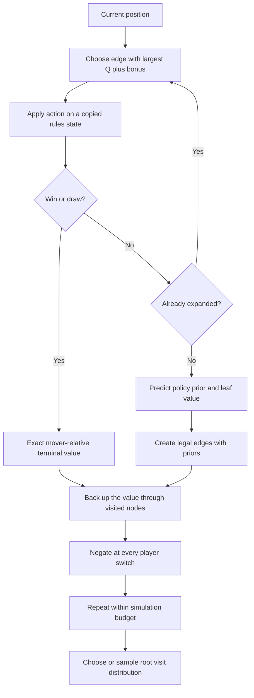
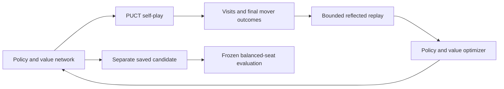

# PUCT: Search Guided by a Policy and Value Network

## Why Add Search?

The measured neural Q agents improved against random play but did not win
against depth-2 alpha-beta. Choosing directly from a network prediction can
miss a short forced loss. Search examines possible continuations first.

PUCT is a selection rule inside Monte Carlo Tree Search (MCTS), not a neural
architecture or a complete learning algorithm. It combines observed search
values with policy priors. The implementation now lives in `rl_puct.py`;
tested mechanics are not a claim of demonstrated strong play.

## Exploitation and Exploration

The existing MCTS engine uses an upper confidence bound (UCB) resembling:

$$
\operatorname{UCB}(s,a)
= Q(s,a) + c\sqrt{\frac{\log N(s)}{N(s,a)}}.
$$

The mean result $Q$ encourages exploitation. The bonus encourages exploration
of actions with fewer visits; unvisited actions need a special convention.
Our original MCTS estimates outcomes through random rollouts.

A common AlphaZero-style PUCT variant instead selects:

$$
a^* = \arg\max_{a\in A(s)}\left[
Q(s,a) + c_{\mathrm{puct}}P(s,a)
\frac{\sqrt{N(s)}}{1+N(s,a)}\right].
$$

| Term | Meaning |
| --- | --- |
| $A(s)$ | Legal columns in the current board |
| $Q(s,a)$ | Mean backed-up action value for this node's mover |
| $P(s,a)$ | Network prior, masked and normalized over legal moves |
| $N(s,a)$ | Number of simulations through this action |
| $N(s)$ | Parent visit count |
| $c_{\mathrm{puct}}$ | Relative strength of the exploration bonus |

Unvisited actions start with $Q=0$ and zero visits. We use
$\sqrt{\max(1,N(s))}$ initially so priors guide the first selection. This is an
explicit implementation convention, not the only possible PUCT design.

**Exploitation** favors actions with good observed values. **Exploration**
favors promising priors whose actions have few visits. PUCT adds both terms
and chooses their maximum on each tree descent; it does not flip a binary
exploration/exploitation switch.

An action's bonus decreases as its own visits grow. Parent visits increase
pressure to investigate alternatives. Bad priors can misdirect search, and
finite budgets do not guarantee that every tactic will be examined.

### Numerical Example

For a parent with 100 visits and $c_{\mathrm{puct}}=1.5$:

| Action | $Q$ | Prior $P$ | Visits | Bonus | Total |
| --- | --- | --- | --- | --- | --- |
| A | 0.60 | 0.50 | 50 | 0.147 | 0.747 |
| B | 0.20 | 0.30 | 5 | 0.750 | 0.950 |

A has better observed results, but B wins this selection because it is
promising and underexplored. If B's results do not improve as it receives
visits, its bonus shrinks and A can become preferable again.

## Neural Network Input and Output

This is a **policy/value network**, different from the existing network that
produces seven Q-values. A shared feature encoder feeds two separate heads.

### Input: The Board

Each position is a tensor of shape `3 x 6 x 7`:

1. Tokens belonging to the player about to move.
2. Tokens belonging to the opponent.
3. Empty cells.

A batch has shape `B x 3 x 6 x 7`. Rows are bottom-first, matching `GameState`.
Swapping token colors and the mover preserves the relative encoding. The
legal-column mask comes from the rules, not from a network prediction.

No opening book, tactical features, alpha-beta answers, or pretrained strategy
are supplied. Architecture is still an inductive bias: zero prior means no
supplied strategy, not ignorance of the game's rules.

### Policy Output: Seven Logits

The policy head produces seven logits, one per column. Mask illegal columns
before softmax to obtain probabilities summing to one over legal moves.
These probabilities are $P(s,a)$ in the PUCT exploration term.

A prior of 0.4 means the network allocates substantial preference to that
action. It does **not** mean the move has a 40% chance of winning, and it is
not the action's Q-value. Search may overturn the prior after observing losses.

### Value Output: One Scalar

The value head produces $v(s)$ in [-1, 1], from the current mover's perspective.
Training labels are +1 for eventual wins, -1 for losses, and 0 for draws.
The prediction estimates expected outcome under learned/search play; it is
not a proof or necessarily a calibrated win probability.

The small CPU network uses shared layers `126 -> 128 -> 64`, then
a seven-logit policy head and one tanh value head. A single prediction supplies
priors and a leaf estimate. It does not itself examine future boards.

## One MCTS Simulation



At a new nonterminal leaf, one network prediction replaces a random rollout
to the end. At a terminal leaf, use the exact game result, not the network.
Search visits are temporary decision state, not learned model parameters.

### Why Backup Changes Sign

If a leaf's mover sees +0.8, its parent mover sees -0.8. Each ply switches
players, so backup alternates the sign. After our winning move, the terminal
board belongs to the opponent to move: its value is -1, backing up to +1
for our action.

Nodes store values from their own mover's perspective. The parent's
exploitation term is therefore the negative of the child's mean value.
This differs from upstream engine scores expressed from player one's view.

## Choosing the Actual Move

After search, use root visit counts rather than the last PUCT selection score:

$$
\pi(a\mid s)
= \frac{N(s,a)^{1/\tau}}{\sum_{b\in A(s)}N(s,b)^{1/\tau}}.
$$

At temperature one, sample in proportion to visits. At zero temperature,
choose a most-visited action with random tie-breaking. Self-play can sample
early moves and become greedy later; evaluation uses greedy selection.

Root Dirichlet noise is a **separate** training mechanism: mix policy priors
with seeded random proportions to broaden experience. It is not the PUCT
bonus and is disabled for evaluation and human play.

## Training the Policy and Value

Record each mover-relative board and its root visit distribution during
self-play. At game end, attach that mover's final outcome. Train with policy
cross-entropy and value error, plus optional weight regularization:

$$
\mathcal{L}
= -\sum_a\pi(a\mid s)\log p_\theta(a\mid s)
  + (v_\theta(s)-z)^2 + \lambda\lVert\theta\rVert^2.
$$

Replay remains capped. Reflection reverses policy columns but preserves the
relative outcome. Resumable snapshots store model, optimizer, replay, settings,
counters, and RNG state. A compact playing export omits training state.
DQN checkpoints cannot be silently converted into two-head policy/value
checkpoints: a new agent begins with untrained weights.



The search policy supplies policy targets; actual outcomes supply value labels.
Alpha-beta does not supply training answers. Neither search nor self-play
guarantees convergence or mastery.

## Implementation and Fair Evaluation

1. Test legal priors, PUCT selection, terminal values, signs, and visit totals.
2. Test policy/value fitting on tiny data and same-environment exact resume.
3. Expose separate PUCT training, play, benchmark, and evaluation controls.
4. Compare untrained network plus search, trained network plus the same search
   budget, and trained network without search.
5. Evaluate both seats against alpha-beta depths 2, 3, and 4 with several seeds,
   recording simulation budgets, timings, model hashes, and uncertainty.

Equal simulations are not equal wall-clock cost versus alpha-beta. Report both.
Search-assisted wins do not prove that the network alone improved. Public
tactical fixtures remain development diagnostics, not mastery certification.

Reference: [AlphaZero paper](https://arxiv.org/abs/1712.01815).

## Runnable Commands

PUCT is an opt-in backend; existing DQN and JSON agents remain available.
Use separate paths for this different network and snapshot format:

```powershell
uv sync --locked --extra rl --dev
uv run --extra rl four-in-a-row-rl train --algorithm puct `
  --episodes 100 --seed 7 --simulations 64 `
  --checkpoint checkpoints/puct_agent.pt `
  --export-model checkpoints/puct_model.pt
```

Resume retains optimizer, replay, RNG, and search settings. Evaluation can
override the simulation budget without writing the checkpoint:

```powershell
uv run --extra rl four-in-a-row-rl train --episodes 100 `
  --resume checkpoints/puct_agent.pt
uv run --extra rl four-in-a-row-rl evaluate --games 100 `
  --checkpoint checkpoints/puct_agent.pt --simulations 512 `
  --opponent alphabeta --strength 2 --seed 12000
uv run --extra rl four-in-a-row-rl evaluate --games 100 `
  --checkpoint checkpoints/puct_agent.pt --no-search `
  --opponent alphabeta --strength 2 --seed 12000
uv run --extra rl four-in-a-row-rl benchmark `
  --checkpoint checkpoints/puct_agent.pt --untrained `
  --simulations 512 --seeds 13000 13001 13002
```

The benchmark's untrained PUCT baseline uses the same initialization seed,
simulation count, exploration constant, and search/no-search mode. Hashes
identify source checkpoint files, not weights of ephemeral untrained models.
Root noise is used only during self-play; it is never enabled by these
evaluation or benchmark commands. Evaluation reports search budgets and time.

To play in your own VS Code terminal:

```powershell
uv run --extra rl four-in-a-row-rl play --p1 human --p2 rl `
  --checkpoint checkpoints/puct_agent.pt --simulations 512
```

Changing `--strength` to 3 or 4 in evaluation selects the corresponding
alpha-beta depth. `--no-search` evaluates only the learned policy head, not
the existing DQN's Q-values. Search controls reject incompatible checkpoints.
Compact exports cannot resume training; overwrite protections still apply.

## First Measured PUCT Experiment

On 2026-10-14, two fresh agents, initialization seeds 7 and 17, each trained
for 100 self-play games using 64 simulations per move. Each has 25032 network
parameters and capped replay of 2000 samples. The compact models are about
108 KB; full training snapshots are about 623 KB.

Evaluation used 512 simulations per move for both untrained and trained
search agents. The trained policy-only mode used zero simulations. Each
seed played 20 balanced-seat games against each alpha-beta depth, using
evaluation seed `22000 + depth`. Combined wins/draws/losses across both seeds:

| Mode | Depth 2 | Depth 3 | Depth 4 |
| --- | --- | --- | --- |
| Untrained network plus search | 0/0/40 | 0/10/30 | 0/0/40 |
| Trained network plus search | 0/0/40 | 20/0/20 | 0/10/30 |
| Trained network without search | 0/0/40 | 0/0/40 | 0/0/40 |

The entire experiment, including training, evaluation, and persistence,
took 678 seconds, about 11.3 minutes. Outputs are in the separate directory
`checkpoints/puct_20261014_222025/`, with `comparison.json` and two resumable
snapshots plus their compact exports. Existing models were not overwritten.

This produced some wins against depth 3, but no depth-2 wins. A fixed
depth-limited heuristic engine is not a monotonic strength oracle: horizon
effects and move-ordering can produce different weaknesses at different
depths. These results do not establish that our agent is generally stronger
than depth 3, or that extra search depth necessarily weakens alpha-beta.

On the correlated 16-case tactical suite, untrained search scored 16/16 for
both seeds; trained search scored 14/16 and 16/16. The trained unaided policy
scored 4/16 for each. Search clearly contributed to these diagnostics, while
training did not improve tactical-suite accuracy over untrained search.

Only two training seeds and mostly deterministic repeated matches were used.
The reported binomial win intervals must not be interpreted as accounting
for all matchup dependence. More openings, opponent seeds, retained-history
checks, and held-out positions are needed before declaring robust progress.
No agent was automatically promoted and the DQN default stayed unchanged.

Try the measured candidate in your own terminal:

```powershell
$run = "checkpoints/puct_20261014_222025"
uv run --extra rl four-in-a-row-rl play --p1 human --p2 rl `
  --checkpoint "$run/puct_seed7_episodes100_model.pt" --simulations 512
```

This identifies a measured candidate, not a certified strongest model.

## Frozen History and Fork-Defense Follow-Up

PUCT training can now mix current self-play with frozen historical policies.
`--opponent-pool-size` caps archived weight copies, `--snapshot-interval`
controls completed-game archival, and `--historical-fraction` controls the
probability of choosing a uniformly sampled archived opponent for a game.
The pool starts with the initial network; old copies are evicted FIFO.

Historical actors share the trainer's checkpointed random stream, use the
same simulation budget, and cannot update their parameters. The learner
alternates token seats and first/second position. Only its own search decisions
generate policy targets in historical matches; game outcomes label its values.
Current self-play games still record both players' decisions. Archival is not
a claim of stronger play or automatic champion promotion.

Version-two snapshots persist the pool, history settings and historical-game
counter. Old version-one snapshots load with history disabled. Compact playing
models omit the pool. Explicit pool overrides on resume do not reset weights;
save to a new path to preserve the source experiment.

The tactical suite is now `connect-four-tactics-v2`: the original 16 cases plus
eight mirrored/color-swapped variants of two opponent-fork defense positions.
These check whether an opponent reply can create two winning columns without
leaving an immediate winning counter-reply. They are shallow rule-derived
diagnostics, not full game-solving labels. Reports retain the original subset
under `legacy_correct` and `legacy_cases`; do not compare 24-case totals directly
with older 16-case totals. Diagnostic answers never enter the trainer.

Evaluation also accepts `--opening-plies` from zero through six. Seeded random
legal prefixes are paired across both learner token seats and recorded in
reports. These broaden positions beyond the empty board; they are not sampled
solver-labelled problems or a guarantee of statistical independence.

```powershell
uv run --extra rl four-in-a-row-rl train --algorithm puct `
  --episodes 1000 --seed 7 --simulations 256 --replay-capacity 10000 `
  --opponent-pool-size 4 --snapshot-interval 100 `
  --historical-fraction 0.5 --checkpoint checkpoints/puct_history_seed7.pt
uv run --extra rl four-in-a-row-rl evaluate --games 100 `
  --checkpoint checkpoints/puct_history_seed7.pt --simulations 512 `
  --opening-plies 4 --opponent alphabeta --strength 2 --seed 41000
```

The staged follow-up measures 100, 250, 500 and 1000 training games, retaining
separate checkpoints and unaided-policy results. Stronger training search,
larger replay and frozen history form a combined experimental condition;
improvement cannot be attributed to the pool alone without a matched ablation.

### Completed Follow-Up Results

Both history-training seeds completed 1000 games. Fresh paired-opening
validation at 512 simulations gave the searched models 54 wins in 120 games
against depth-2 alpha-beta and 61 in 120 against depth 3. Previous 100-game
models won 22 and 35 under the same protocol. Both final searched candidates
passed all 24 development tactical cases, but their unaided policies were
still substantially weaker. See the
[completed experiment notes](rl_lessons_learned.md#completed-history-experiment-and-cross-seed-validation)
for full win/draw/loss records, caveats, and the seed-17 play command.

These measurements support practical search-assisted progress, not a certified
champion or isolated proof of the history pool's benefit. Defaults and existing
playing checkpoints were not overwritten.
