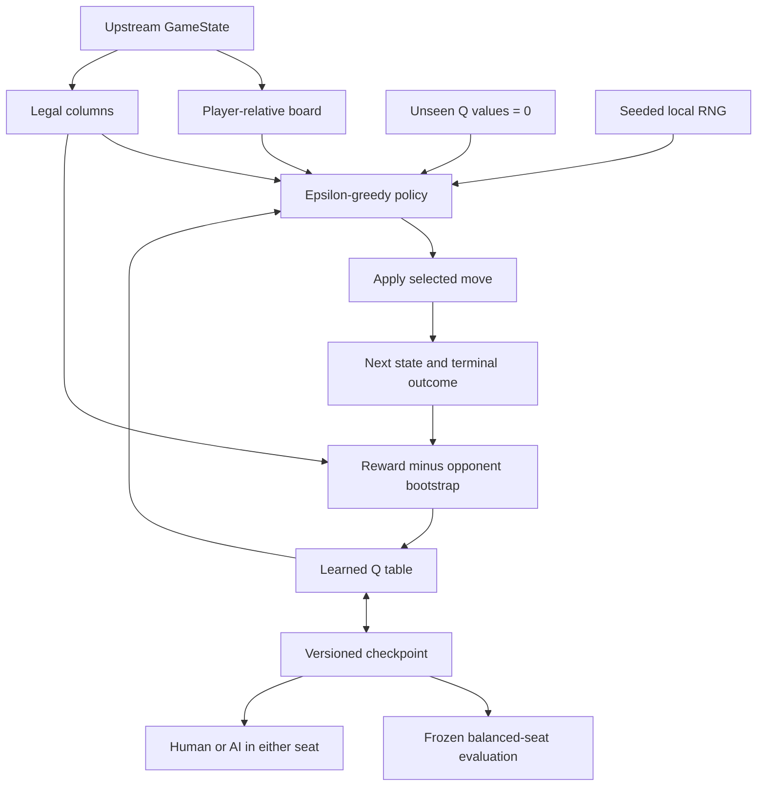
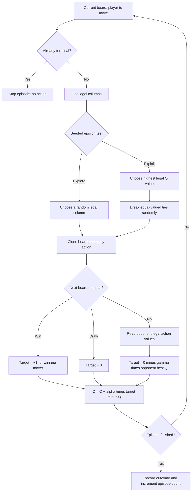
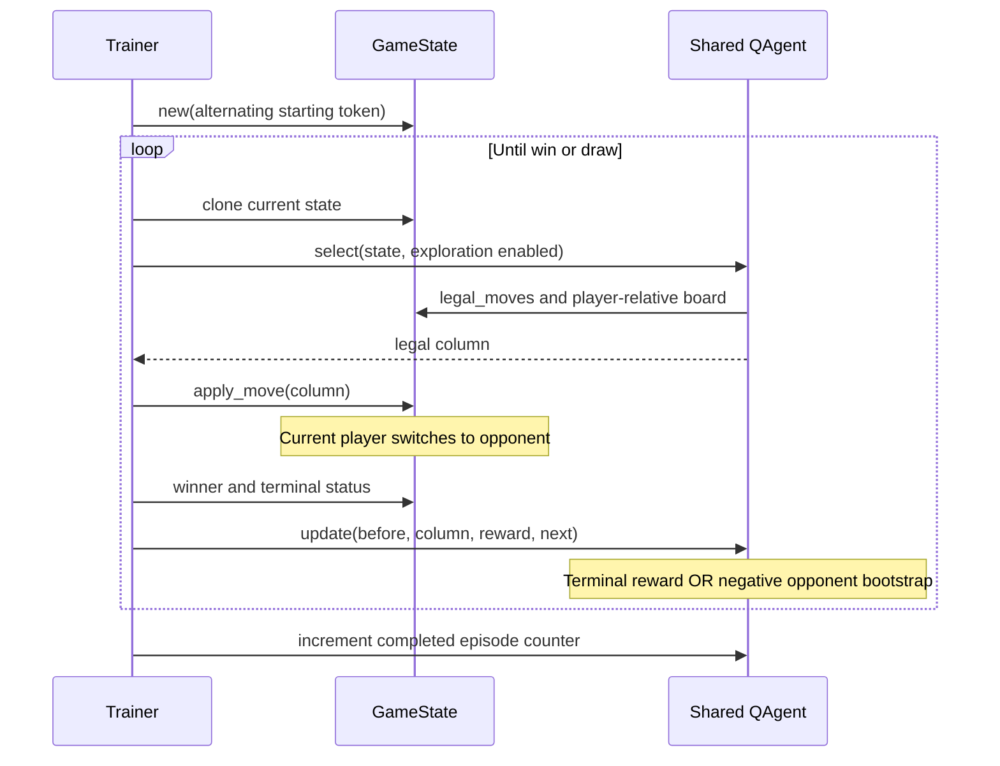
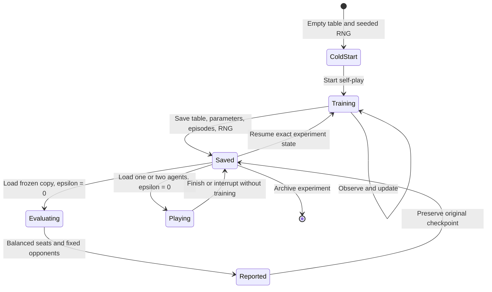
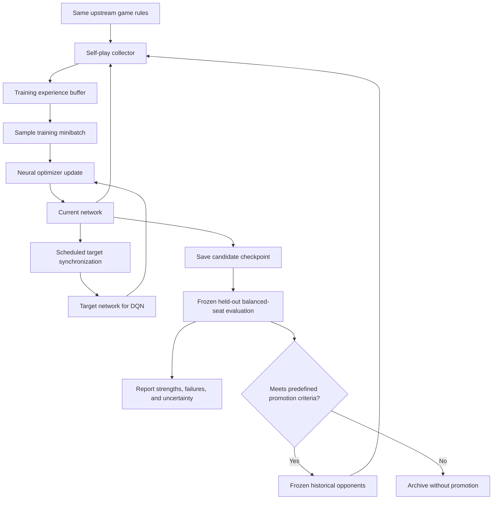

# Reinforcement Learning: From Rules to Learned Play

## Scope and Current Status

We build on [OMerkel/four_in_a_row](https://github.com/OMerkel/four_in_a_row/tree/main/python),
not on a replacement rules implementation. Its `GameState` is the environment:
it applies gravity, switches turns, enumerates legal columns, and detects wins
and draws. Its existing random, alpha-beta, and MCTS engines are useful opponents
for evaluation. Their heuristic scores and suggested moves are **not training
targets** for the zero-prior learner.

The learning module is `four_in_a_row/rl.py`, verified by `tests/test_rl.py`.
`four_in_a_row/rl_cli.py` implements training, frozen evaluation, and configurable
seats, verified by application and subprocess tests in `tests/test_rl_cli.py`.
Later stages below are architectural intent, not
claims that a neural agent or a master-strength player already exists.

The default trainer now uses a small CPU Double DQN network with bounded replay.
See [the neural implementation notes](rl_lessons_learned.md#replace-the-q-table-with-a-small-nn)
for architecture, targets, storage, and runnable commands. Existing JSON tables
remain a baseline; new neural agents start from random, untrained weights.

Neural agents optionally collect completed-game returns and mix them with the
Double DQN target. This gives both winning and losing actions direct outcome
labels. TD-only stays the default; `--outcome-weight 0.5` opts into mixed targets.
Old checkpoints preserve
their saved behavior. The new `benchmark` command compares frozen policies on
16 evaluation-only win, block, safety, and double-threat cases. See
[credit assignment and diagnostics](rl_lessons_learned.md#improving-credit-assignment-and-measuring-tactics)
for commands, mathematics, and limitations. Neither feature proves mastery.

The original algorithm is tabular, player-relative Q-learning. It is deliberately
small enough to understand, inspect, and test. It needs no extra ML dependency.
It is a learning baseline, **not a practical route to solving the entire game**:
there are trillions of legal positions, and a table cannot generalize between
positions it has not visited.

## What Zero Knowledge Means

For the next search-assisted path, read [PUCT explained](puct.md). The new
`--algorithm puct` backend learns policy and value heads from search visits
and game outcomes. Existing DQN settings remain the default. Explicit
`--simulations` and `--no-search` controls distinguish search strength from
network-only strength; no DQN checkpoint is silently converted.

The agent initially has no learned strategy, opening book, demonstration games,
pretrained weights, tactical features, center-column preference, or search
teacher. It still needs the game's rules, available actions, observations, and
objective. No meaningful learning environment is literally knowledge-free.

The only training reward is the game outcome. The board encoding distinguishes
empty, own, and opponent cells; this is a representation choice, not a supplied
strategy. In a later neural implementation, the network architecture itself
will also be an inductive bias, even when weights are randomly initialized.

## The Seven Pieces and Why Each Is Needed

| Piece | Why learning needs it | Dependency and acceptance evidence |
| --- | --- | --- |
| Zero-initialized values | Give unseen states a neutral starting estimate, without a handcrafted strategic preference. | Random tie-breaking and exploration must keep a neutral table from always choosing the first column. `test_cold_start_and_player_relative_encoding`, `test_mask_and_random_ties`. |
| Legal moves | Restrict behavior and bootstrap targets to actions the environment can actually execute. A full column must never win an argmax just because its unused value is higher. | Uses `GameState.legal_moves()` for both selection and updates. `test_mask_and_random_ties`; upstream game tests verify gravity and legality. |
| Terminal rewards | Define what successful play means and provide the signal that eventually reaches earlier decisions. | A winning move receives +1, a draw 0; terminal states have no bootstrap value. `test_opponent_bootstrap_and_terminal_reward`. |
| Opponent-relative updates | Respect the fact that the next decision belongs to the other side in a zero-sum game. | Requires a consistent player-relative encoding and a negative bootstrap term. `test_opponent_bootstrap_and_terminal_reward`. |
| Deterministic self-play | Generate experience without a teacher and make implementation bugs reproducible. | One agent supplies both seats, uses a local seeded RNG, and alternates the starting token. `test_seeded_self_play_and_checkpoint_resume`. |
| Checkpoint resume | Preserve learned values and experimental state across sessions instead of starting over. | Store table, hyperparameters, episode counter, and RNG state. `test_seeded_self_play_and_checkpoint_resume`, `test_reject_invalid_checkpoint`. |
| Training/play CLI | Make experiments and human inspection repeatable through explicit commands and independently configured seats. | Train writes a checkpoint; evaluation and play read it without learning. `test_train_evaluate_play_e2e`, `test_evaluation_is_balanced_and_frozen`, `test_human_combinations`. |

These are not independent features. Legal-action masking and correct perspective
make the update meaningful. Rewards create a learning signal; self-play supplies
the transitions; exploration supplies variety; checkpoints preserve progress;
the CLI makes the same agent available to training, measurement, and people.



## Tabular Baseline: State, Actions, and Policy

`Q(s, a)` estimates the eventual return for taking column `a` in position `s`,
from the perspective of the player about to move. The state key has 42 cells,
bottom row first, encoded as `0 = empty`, `1 = self`, and `2 = opponent`.
Swapping token colors and the player to move produces the same key. We reuse
knowledge across colors without changing the upstream board representation.

Unseen keys return seven zeros without creating a table entry. Learning inserts
entries; frozen inference must not grow the table. The table is not currently
canonicalized by left/right reflection. Symmetry augmentation is a later step.

With probability epsilon, choose a uniformly random **legal** column. Otherwise
choose a highest-valued legal column, breaking ties randomly. Exploration
prevents immediate commitment to the first accidental success. Tie-breaking
prevents a cold-start leftmost-column bias even when epsilon is zero.

At evaluation and human-play time epsilon is zero, but tied choices remain
stochastic. Seeding makes these choices reproducible; it does not make the
policy intrinsically deterministic.

## The Update and the Sign

For a transition from state `s`, through action `a`, to `s_next`, use:

$$
y = \begin{cases}
r & \text{if the next state is terminal},\\
r - \gamma \max_{b \in A(s_{next})} Q(s_{next}, b)
  & \text{otherwise},
\end{cases}
$$

$$
Q(s,a) \leftarrow Q(s,a) + \alpha\bigl(y-Q(s,a)\bigr).
$$

Here `A(s_next)` is the next player's legal action set, alpha is the learning
rate, and gamma is the discount factor. Defaults are alpha 0.2, gamma 1.0,
and epsilon 0.2. Gamma 1.0 treats every eventual win equally; a smaller gamma
discounts distant outcomes. These are initial experimental settings, not tuned
optimal values.

**Worked example:** our current value is 0, reward is 0, the opponent's best
next value is +0.5, gamma is 0.9, and alpha is 1. The target is -0.45, so our
move's new value is -0.45. Using +0.45 would teach us to give the opponent good
positions. If instead our move wins immediately, the target is +1 regardless
of stored values in the terminal board.

The winning mover receives +1 and a draw receives 0. We do not separately
inject -1 into the previous move: losing decisions acquire negative values
through the opponent bootstrap. Online updates propagate this information over
repeated visits; a single game does **not** back-propagate its final outcome
through every earlier move. This is one reason a short run will not learn
reliable strategy. A later Monte Carlo alternative could explicitly update
all recorded moves from the final outcome.

The training path does not call upstream `evaluate_state()` or any search
engine. `test_learning_does_not_use_heuristics` guards against heuristic leakage.

### Update Decision Flow

This diagram follows one observed transition. Action selection and the
nonterminal bootstrap each use a legal-action mask; the bootstrap is read from
the opponent's perspective. No actions or estimated future values are read
after the game ends.



## One Self-Play Episode



Both seats use the same table. This is self-play, not learning from a fixed
random teacher. Initially, play looks random because every value is zero.
As the table changes, the opponent changes too. Standard fixed-environment
Q-learning convergence guarantees must not be assumed for this evolving,
finite-budget self-play setup. Fixed alpha and epsilon are baseline choices;
scheduled exploration and frozen opponent pools need separate experiments.

## Legacy Tabular Reproducibility and Resume

A version-1 JSON checkpoint stores the algorithm identifier, table, alpha,
gamma, epsilon, initial seed, completed episodes, and full Python RNG state.
The initial seed alone is insufficient for exact continuation: it would restart
the random sequence instead of continuing it. The episode counter also preserves
which token starts the next game.

Saving writes a temporary file and replaces the destination. Loading checks
format/version, table dimensions, finite bounded action values, and metadata.
JSON avoids executing pickle payloads. Treat checkpoints as trusted local
artifacts nevertheless: there is not yet a file-size limit or a guarantee
against maliciously large JSON input.

The intended resume contract is: train N episodes, save/load, then train M
episodes, and obtain the same table and RNG state as continuing the in-memory
agent for M episodes. This is tested within the same Python/project version,
not promised across Python versions, algorithm changes, or hardware backends.
For resumed training, checkpoint hyperparameters take precedence over fresh-run
CLI defaults; changing them should be an explicit, recorded new experiment.

### Checkpoint Lifecycle

Training is the only workflow that updates action values. Evaluation clones the
loaded agent and disables exploration; play also disables exploration. Neither
workflow writes learned values back to the checkpoint. Loading does not prove
playing strength: measurement remains a separate step.



## CLI Workflow

The following commands use the implemented neural CLI. Use `uv sync --extra rl --dev`
to create the root `.venv`; all commands
below use its interpreter automatically through `uv run`.

```powershell
# Start without learned values.
uv run --extra rl python -m four_in_a_row.rl_cli train --episodes 1000 --seed 7 --checkpoint checkpoints/nn_agent.pt --export-model checkpoints/nn_model.pt

# Continue the same experiment, including its RNG stream.
uv run --extra rl python -m four_in_a_row.rl_cli train --episodes 1000 --resume checkpoints/nn_agent.pt

# Measure without training; use both seats equally.
uv run --extra rl python -m four_in_a_row.rl_cli evaluate --games 200 --seed 1000 --checkpoint checkpoints/nn_agent.pt

# Compare against a fixed search baseline.
uv run --extra rl python -m four_in_a_row.rl_cli evaluate --games 200 --opponent alphabeta --strength 2 --checkpoint checkpoints/nn_agent.pt

# A human can occupy either seat; two RL players are also supported.
uv run --extra rl python -m four_in_a_row.rl_cli play --p1 human --p2 rl --checkpoint checkpoints/nn_agent.pt
uv run --extra rl python -m four_in_a_row.rl_cli play --p1 rl --p2 human --checkpoint checkpoints/nn_agent.pt
uv run --extra rl python -m four_in_a_row.rl_cli play --p1 rl --p2 rl --checkpoint checkpoints/nn_agent.pt
```

Fresh training refuses to overwrite existing outputs; use a new path or
`--overwrite` deliberately. Resume automatically updates its source path.
Neural snapshots include bounded replay and optimizer state; optional
`--export-model` files are smaller and cannot resume training. Refreshing an
existing export also requires `--overwrite`. Legacy JSON checkpoints still
load automatically; `--algorithm tabular` selects new tabular training.

Training reports episode totals, parameter count, replay size, loss, and bytes.
Tabular runs report table size instead. Frozen evaluation reports
wins/losses/draws, equal seat counts, opponent settings, seed, checkpoint digest,
score `(wins + 0.5 * draws) / games`, and a Wilson 95% interval for **win rate**.
That interval treats draws as non-wins; it is not an interval for score. Games
sharing a policy and random stream are not guaranteed statistically independent,
so report multiple independent training and evaluation seeds as well.

Self-play win counts alone do not demonstrate progress: one side must win even
if both play badly. Compare saved checkpoints against frozen opponents and the
untrained policy under the same seat-balanced protocol. Do not tune against the
final held-out evaluation seeds.

The original CLI/GUI remain available. The first RL integration is a separate
terminal entry point; loading learned agents inside the matplotlib GUI is not
yet part of the implemented workflow.

## Step-by-Step Plan

| Stage | Work and learning goal | Acceptance gate | Status |
| --- | --- | --- | --- |
| 0. Preserve the foundation | Import upstream Python rules, engines, CLI, GUI, license, and tests. Understand the distinction between search and learning. | Upstream 144 tests pass; statement and branch baseline 100%. | Done |
| 1. Learn the mechanics | Implement zero-prior tabular self-play, masking, signs, terminal outcomes, and exact resume using TDD. Inspect individual Q updates. | Focused learner tests pass, including no heuristic reward and resume equivalence. | Implemented |
| 2. Make experiments usable | Train/evaluate/play CLI, independent player seats, subprocess e2e tests, architecture, FR/NFR traceability, and separate quality gates. | CLI workflows pass; statement, branch, and function-entry coverage each strictly above 95%; requirement KPI reports actual passed evidence. | Implemented |
| 3. Establish honest baselines | Run untrained and trained tables at increasing budgets, with several seeds, balanced seats, random/search opponents, frozen checkpoints, timings, and memory measurements. | Reproducible reports; disclose lack of improvement rather than adjusting evaluation rules. | Planned |
| 4. Generalize with a neural Q function | Optional CPU PyTorch extra, three observation planes, small network, capped replay, target network, masked Double DQN, reflection, resumable snapshots and compact exports. | Targets, replay, tiny-dataset fit, storage bounds and exact resume are tested. Multi-seed playing-strength improvement still requires experiments. | Implemented mechanics; strength unverified |
| 5. Stabilize self-play | Add frozen historical opponent pools, checkpoint promotion, explicit exploration schedules, and reflection augmentation. | No training/evaluation leakage; held-out balanced-seat improvement without catastrophic forgetting. | Planned |
| 6. Investigate AlphaZero-style learning | Train a policy/value network with PUCT self-play; use terminal outcomes as value labels and search visit counts as policy labels. | Verify mask, perspective signs, normalized policy targets, reproducibility, and measured improvement at comparable compute budgets. | Planned alternative to DQN |
| 7. Assess strong play | Compare against strong fixed engines and an independently verified solver on a held-out position suite, including first/second-seat behavior. | Predeclare tactical accuracy, mistake rate, opponent strength, compute budget, and confidence criteria; report evidence before using the word mastership. | Planned |

Stages 4 and 6 are alternative research paths, not a requirement to implement
both before learning anything. Start with the table to understand the loop,
then prefer neural generalization for scale. For PUCT, do not simply reuse
upstream MCTS's heuristic evaluation: learned policy/value predictions and
training targets require an explicit new contract.

### Planned Neural Self-Play Loop

The following is a **future** architecture, not the current tabular trainer.
Experience collection and gradient updates become separate responsibilities.
Frozen evaluation is outside the feedback loop; held-out evaluation outcomes
must never become training samples or reward shaping.



Connect Four is solved: perfect first-player play can force a win. A strong
second-player agent cannot guarantee a draw against a perfect first player.
Overall win rate therefore cannot alone certify mastery. No training budget
in this plan guarantees master-strength play.

## TDD, Requirements, and Project KPIs

Tests are written before each implementation slice. Learner unit tests isolate
the update mathematics and boundary conditions; application tests validate
orchestration; subprocess e2e tests use the actual interpreter and module entry
point, temporary checkpoints, and finite timeouts.

Test-suite header comments identify requirement IDs, including `FR-RL-001`
through `FR-RL-005`, `FR-PLAY-001`, `FR-EVAL-001`, and `NFR-RL-001`. The
[requirements register](requirements.md) maps IDs to named suites/cases and
tracks implemented versus planned requirements. A name in a document is not proof of
coverage: the KPI must consume actual test results and reject stale links.

Track requirement pass coverage separately from statement, branch, and function
coverage. `pytest-cov` does not natively give a separate function metric;
`scripts/quality.py` measures named-function body entry against the AST using
executed coverage lines. This is entry coverage, not full path coverage, and
excludes lambdas and generated methods as documented in the requirements.
It enforces each metric above 95%, not the combined coverage.py percentage,
and checks requirement links against test-suite headers and JUnit results.
Quality coverage does not measure playing strength; frozen evaluation does.

```powershell
uv run --extra rl pytest
uv run python -m scripts.quality
uv run zensical build
```

## Try These Learning Experiments

1. Inspect an empty state's seven zero values. Ask why deterministic leftmost
   tie-breaking would add a hidden bias.
2. Reproduce the -0.45 update above and compare it with the intentionally wrong
   positive-sign equation in a test-only experiment.
3. Fill a column and give it the highest stored value. Confirm that the agent
   still chooses only legal columns.
4. Train a small run. Inspect which terminal moves become positive and notice
   that most unseen positions still behave randomly.
5. Save/resume and compare with uninterrupted training before making any claim
   about reproducibility.
6. Compare frozen checkpoints at several episode counts. Keep failed
   experiments: they explain why neural generalization is the next question.

Further reading: Sutton and Barto, *Reinforcement Learning: An Introduction*,
[official book page](http://incompleteideas.net/book/the-book-2nd.html);
[AlphaZero paper](https://arxiv.org/abs/1712.01815). These are conceptual guides,
not dependencies or promises of equivalent performance.
