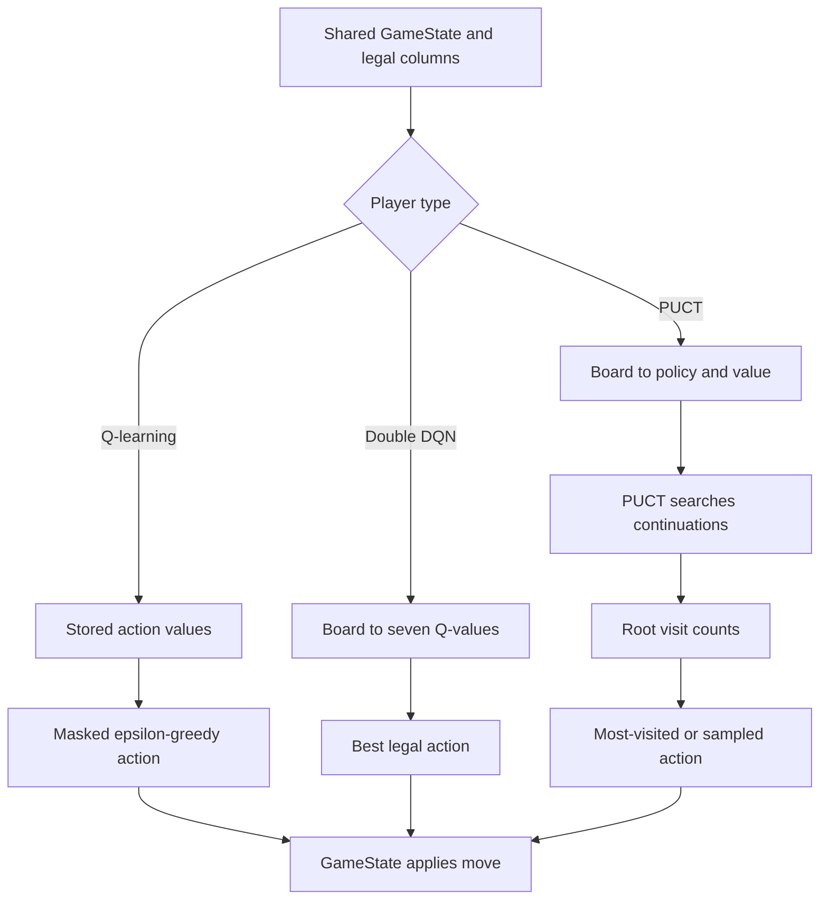
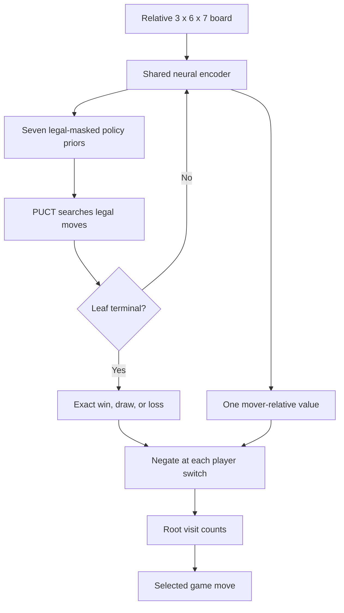

# Reinforcement Learning: A Beginner's Guide

## What Is Already in the Game?

The project uses one shared rules implementation, `GameState`, with several
ways to choose moves. Classical engines include random play, minimax,
alpha-beta, negamax, and rollout-based MCTS. The reinforcement-learning agents
are additional players; they do not replace those engines or the game rules.

This project now contains three distinct learning approaches:

- Tabular Q-learning
- Double DQN
- PUCT Policy/Value

### Tabular Q-learning

Tabular Q-learning stores a value for each visited board and action.
It keeps a table of scores for possible moves in different game situations,
updating them as it learns.
It chooses among legal columns using those values and exploration.

Tabular Q-learning stores values only for positions it visits, but it cannot
generalize between different boards. Four in a Row has an enormous state
space, so broad table coverage is impractical. Symmetry can reduce duplicate
positions; a neural network can generalize across related positions instead.

As an expected outcome any learned data is huge in size for a game like
Four in a Row. Plain tabular Q-learning can require an enormous table for
Four in a Row because there are trillions of possible legal board positions,
each with up to seven moves (the seven columns a player may be eligible to
place his next game piece if column is still free).
Only storing visited board–action pairs
reduces storage, but broad coverage is still impractical; limited training
produces a smaller, incomplete table. Exploiting board symmetry helps;
replacing the table with a neural network is a common way to generalize
across positions.

### Double DQN at a Glance

DQN means Deep Q-Network. The network estimates the expected long-term reward
(Q-value) for each possible action.

Double DQN reduces overestimation by separating action selection from action
evaluation during training.

In reinforcement learning, an **action** is one choice the agent can make in
the current state. In Four in a Row, an action is dropping a token into a
column. The board has seven columns, but a full column is not a legal action.
So the legal action set changes as the game progresses:

$$
A(s) = \{c \mid \text{column } c \text{ is not full in state } s\}.
$$

The Python engine uses column indices `0` through `6`; the interactive CLI
displays columns `1` through `7`. “Human,” “DQN,” and “PUCT” describe players
or policies that choose actions; they are not different kinds of game action.

Double DQN estimates values for the seven possible columns, then masks full
columns and chooses among the remaining legal actions. It chooses directly,
without tree search.

### PUCT Policy/Value

PUCT stands for Predictor + Upper Confidence bounds applied to Trees;
it is also called Polynomial UCT.

As such PUCT Policy/Value predicts a policy prior over these
seven actions (the still available columns to place player tokens) and
a value for the board. PUCT uses those predictions to guide
Monte Carlo Tree Search (thus selecting between Exploration and Exploitation
of moves).

For casual explanations, “AI” refers to the move chooser. It does not imply
that the agent is pretrained or already strong. The PUCT agent starts with
random network weights; the rules and board encoding are supplied. Therefore,
“zero knowledge” means no strategy labels or pretrained policy, not literally
no prior information: the input representation, legal moves, reward, network
shape, and search algorithm are all design choices.

## A Move: Three Different Paths



The same rules decide gravity, legal actions, wins, and draws for every player.
The search and learning modules do not maintain alternative rules.

## What “Heuristic” Means Here

A **hand-written heuristic** is a programmer-provided preference or score,
such as a bonus for center-column tokens. The classical search engines use
`game.evaluate_state()` at nonterminal leaves; that evaluator includes a small
center-column bonus and open-window scores.

The tabular, DQN, and PUCT learning paths do not call `evaluate_state()` to
choose or train their policies. Their training targets come from game outcomes
and, for PUCT, its own search-visit distributions. The center preference used
by the classical engines is not injected as a PUCT prior.

Fork-defense fixtures in `rl_benchmark.py` are evaluation-only. They score a
policy on pinned positions; those expected moves are not added to replay and
are not supplied to the trainer. PUCT still uses exact rules to mask illegal
columns and recognize terminal wins or draws.
That is rule enforcement, not a positional heuristic.

The network may learn center preference, direct-threat defense, or fork
patterns from its self-play experience. PUCT search may discover a tactic if
its simulations examine the relevant continuation. Neither is guaranteed to
do so: learned knowledge is approximate and search is bounded by its simulation
budget. “No handcrafted heuristic” does not mean “no useful prior”; network
architecture, legal masks, rewards, and PUCT itself shape behavior.

## From Tabular Values to Neural Networks

### Tabular Q-Learning

`four_in_a_row/rl.py` stores seven action values for each mover-relative board
key. Unseen positions start at zero. It explores with legal random moves and
updates values from wins, draws, and the opponent's next values. “Negamax” in
this context describes the sign change between alternating players; it does
not mean that this learner calls the standalone negamax search engine.

The table memorizes exact positions and cannot generalize to unseen boards.
That is why the project moved on to neural function approximation.

### Double DQN

`four_in_a_row/rl_nn.py` receives three one-hot board planes:

1. Cells belonging to the player to move.
2. Cells belonging to the opponent.
3. Empty cells.

One-hot means that exactly one of the 6 x 7 planes has a logical 1,
while the other planes must hold 0. Due to the three states
(board position is either owned by own token or opponent token or empty)
the NN input is 3 x 6 x 7 using a one-hot encoding approach.

The planes have shape `3 x 6 x 7`; rows are bottom-first. A small MLP maps the
126 input numbers through layers `126 -> 128 -> 64 -> 7`. Its seven bounded
outputs estimate mover-relative action values. Legal-column masking is applied
before action selection and before the bootstrap maximum.

MLP means multilayer perceptron—a feedforward neural network with fully connected layers.

Here, 126 → 128 → 64 → 7 means:

- **126 inputs**: the flattened three board planes.
- **Two** hidden layers: 128 and 64 neurons.
- **7 outputs**: one estimated action value for each column.

Double DQN uses an online network to select the opponent's best legal next
action and a target network to evaluate it. Replay is capped, horizontal
reflection augments each transition, and target weights synchronize on a
schedule. Optional completed-game return labels can be enabled with
`--outcome-weight`; zero keeps TD-only learning. The mode is experimental and
is not evidence of stronger play by itself.

## PUCT: Search Guided by a Different Neural Network

The current advanced player is the separate `PUCTAgent` in
`four_in_a_row/rl_puct.py`. It is not the DQN network reused inside an MCTS
wrapper. Its policy/value network has shared `126 -> 128 -> 64` features and
two heads:

| Head | Output | Role |
| --- | --- | --- |
| Policy | Seven logits | Prior probabilities for legal actions |
| Value | One `tanh` scalar | Estimated outcome for the mover |

Policy probabilities guide exploration. The value estimates nonterminal leaves;
it is not a proof or a calibrated probability. Terminal leaves use exact rule
outcomes. Values change sign at each player switch during backup.

For each tree edge, PUCT balances the edge's backed-up value against an
exploration bonus influenced by the policy prior and visit counts. The network
is the guide; MCTS is the lookahead. After the requested simulations, the move
is selected from root visit counts. More simulations increase decision time,
not training episodes or network knowledge.



### How PUCT Learns

During self-play, record each learner decision's mover-relative board and the
root visit distribution. At game end, attach +1 for a learner win, -1 for a
loss, or 0 for a draw. Train policy logits toward the visit distribution and
the value head toward the final outcome. PUCT's search improves the decisions
used to produce policy targets; alpha-beta does not provide teacher labels.

The optional historical-opponent pool archives frozen network weights and
samples them for some games. It is capped and stored in resumable snapshots.
This adds opponent diversity; it does not guarantee the archive is stronger.
Historical matches add only the learner's actions to replay. Current self-play
can add both seats.

## Current Playing-Strength Evidence

Two PUCT training seeds, 7 and 17, each completed 1,000 self-play games with
256 search simulations during training, a four-policy historical pool, and
10,000 replay capacity. Candidates were evaluated with 512 simulations per
move, 20 balanced-seat games per evaluation seed and depth, and paired legal
four-ply openings. Fresh validation used seeds 61000, 62000, and 63000.

| Mode | Alpha-beta depth 2 | Alpha-beta depth 3 |
| --- | ---: | ---: |
| Mode | Depth 2 wins | Depth 3 wins |
| --- | ---: | ---: |
| Untrained network plus search | 25/120 | 19/120 |
| Previous 100-game network plus search | 22/120 | 35/120 |
| 1,000-game historical network plus search | 54/120 | 61/120 |
| Same trained policy without search | 14/120 | 8/120 |

This is promising **search-assisted** improvement over the measured baselines,
not proof of general mastery. The unaided network is still weak. Only two
training seeds were tested; paired evaluation openings mean results are not
independent samples. The historical pool, search budget, and larger replay were
changed together, so this run cannot isolate which change helped most.

The complete per-seed outcomes, fork-defense scores, checkpoint hashes, and
limitations are recorded in
[RL lessons learned](rl_lessons_learned.md#completed-history-experiment-and-cross-seed-validation).
Existing DQN models and defaults remain unchanged.

## Try the Agents

Install the optional CPU neural dependency in the project environment:

```powershell
uv sync --locked --extra rl --dev
```

Train a fresh PUCT agent with historical opponents and save a resumable
snapshot plus a compact play-only export. Choose a new path or `--overwrite`
if the destination already exists:

```powershell
uv run --extra rl four-in-a-row-rl train --algorithm puct `
    --episodes 1000 --seed 7 --simulations 256 `
    --opponent-pool-size 4 --snapshot-interval 100 `
    --historical-fraction 0.5 --replay-capacity 10000 `
    --checkpoint checkpoints/puct_seed7.pt `
    --export-model checkpoints/puct_seed7_model.pt
```

Compare a trained search player, a same-seed untrained search player, and the
trained network without search:

```powershell
uv run --extra rl four-in-a-row-rl benchmark `
    --checkpoint checkpoints/puct_seed7_model.pt --untrained `
    --simulations 512 --seeds 61000 62000 63000
```

Play against PUCT in your own terminal:

```powershell
$run = "checkpoints/puct_history_20261014_234528"
uv run --extra rl four-in-a-row-rl play --p1 human --p2 rl `
    --checkpoint "$run/history_seed17_episodes1000_model.pt" `
    --simulations 512
```

Use the full `.pt` snapshot with `--resume` to continue training. The
`_model.pt` inference export is smaller but cannot resume training. All game
interfaces use the same `GameState` rules; the PUCT agent is currently exposed
through the RL terminal CLI rather than the original matplotlib GUI.
