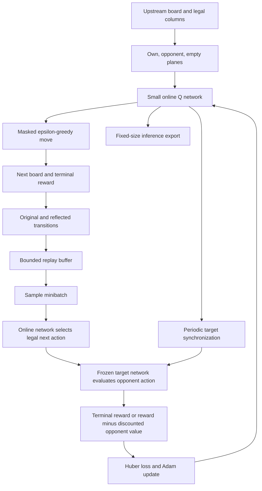
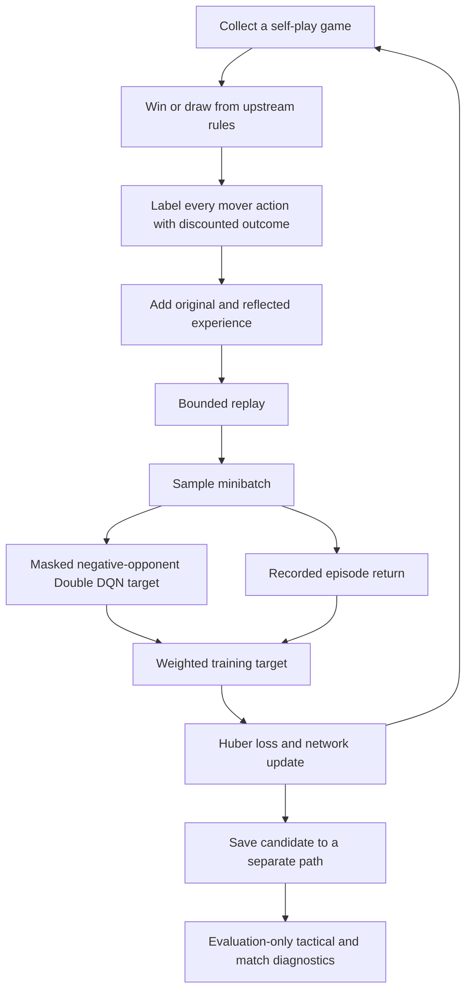

# RL lessons learned

## Search-Assisted Policy and Value Learning

The next path is now implemented as an opt-in PUCT policy/value agent.
[PUCT explained](puct.md) covers exploration, exploitation, NN inputs and
outputs, sign-correct backup, commands, and measured comparisons. Its first
two-seed experiment produced wins against depth-3 alpha-beta with search,
but none against depth 2; the unaided learned policy had no wins. This is
limited matchup evidence, not a general strength or mastery claim.

## Storing the Q-table in a checkpoint/q_agent.json

**The next step is replacing the Q-table with a small neural network**,
rather than adding millions more tabular episodes. This is stage 4 in the
learning plan.

The table memorizes each exact board separately. Most positions encountered
during human play are unseen, so the agent still chooses randomly there.
Larger checkpoints store more memories, but provide no generalization.

A neural network learns shared patterns across positions. Its parameter
count stays fixed as training continues, so model-checkpoint size does not
grow with every visited board. That does not guarantee stronger play or
eliminate the need for substantial training.

I recommend **masked, opponent-relative Double DQN** as the next educational implementation:

1. **Board input:** own-token, opponent-token, and empty-cell planes.
2. **Small PyTorch network:** outputs seven action values, preserving
    legal-column masking.
3. **Bounded replay buffer:** stores recent transitions in memory, with
    optional persistence separate from model checkpoints.
4. **Target network:** stabilizes learning; retain the negative opponent
    bootstrap and terminal handling.
5. **Reflection augmentation:** learn from both a board and its horizontal
    mirror, reversing action indices.
6. **Frozen evaluation:** compare checkpoints against the untrained network,
    random play, and fixed alpha-beta depths across several seeds and both seats.

Use TDD first for masks, perspective signs, terminal targets, target
synchronization, reflection mapping, and checkpoint resume. Then verify that
the network can fit a tiny transition dataset before running large experiments.

**DQN is the manageable next learning step; policy/value learning with PUCT
is the later alternative for pursuing stronger play.** Neither should be
called an improvement until held-out evaluation demonstrates it.

## Replace the Q-table with a small NN

### Implemented Approach

The default trainer now uses `NeuralAgent` in `four_in_a_row/rl_nn.py` instead
of adding entries to `QAgent.table`. The tabular implementation remains as a
regression baseline, and existing JSON checkpoints can still be loaded with
the original engine. Neural training starts fresh: old table entries are not
automatically converted into network weights or used as teacher labels.

The CPU model flattens three 6x7 observation planes into 126 inputs, then uses
layers `126 -> 128 -> 64 -> 7`. ReLU hidden layers and a tanh output bound values
to [-1, 1]. Its 24967 parameters are independent of how many boards are visited.
Random initial weights are an untrained prior, not seven exactly zero outputs.

Double DQN uses the online network to choose the opponent's best **legal** next
action, and the frozen target network to evaluate that action. The target is
the reward minus the discounted opponent value; terminal targets contain only
the outcome reward. Adam minimizes Huber loss, with gradient clipping.

Replay holds at most 5000 transitions by default. Each observed move inserts
the original transition and its horizontal reflection; columns, next-action
masks, and action indices are all reversed together. Once replay reaches its
cap, old samples are discarded rather than expanding disk usage indefinitely.
Updates begin at 128 stored samples and run every four actual moves with
64-sample minibatches; target weights synchronize every 200 optimizer steps.



### Training and Playing

Run these commands in **your own VS Code terminal** so you control game input:

```powershell
uv sync --locked --extra rl --dev
uv run --extra rl four-in-a-row-rl train --episodes 1000 --seed 7 `
    --checkpoint checkpoints/nn_agent.pt `
    --export-model checkpoints/nn_model.pt
uv run --extra rl four-in-a-row-rl evaluate --games 200 --checkpoint checkpoints/nn_model.pt
uv run --extra rl four-in-a-row-rl play --p1 human --p2 rl --checkpoint checkpoints/nn_model.pt
```

If the CPU wheel index reports an unknown certificate issuer on Windows, use
`uv --native-tls sync --locked --extra rl --dev`; keep certificate validation on.

Resume from the **training snapshot**, not the inference export:

```powershell
uv run --extra rl four-in-a-row-rl train --episodes 1000 --resume checkpoints/nn_agent.pt
```

Resume defaults to updating the resumed path. Fresh training refuses to replace
an existing checkpoint. `--overwrite` deliberately replaces an existing output;
for a new experiment, prefer new paths. To refresh the existing inference model
while resuming, provide `--export-model checkpoints/nn_model.pt --overwrite`.

`nn_agent.pt` includes online/target weights, Adam state, bounded replay, RNG,
hyperparameters, and training counters. `nn_model.pt` omits replay, target, and
optimizer state and is below 150000 bytes for this architecture. Training
snapshot size grows only until replay fills. Model checkpoints therefore avoid
the unbounded board-by-board growth of the old JSON table.

PyTorch checkpoints use `weights_only=True`, not unrestricted object loading.
Use trusted local files: restricted loading is not a memory-exhaustion defense
against arbitrarily large tensor files.

### What the Tests Demonstrate

`tests/test_rl_nn.py` verifies encoding, legal masks, the negative Double DQN
target, terminal handling, reflection, target synchronization, replay capacity,
tiny-dataset fitting, exact same-environment resume, compact model exports, and
malformed-file rejection. `tests/test_rl_cli.py` runs real subprocess training,
resume, evaluation, and play and verifies overwrite protection.

The tiny-dataset test proves that this implementation can optimize a learned
value function. It does **not** prove stronger play. Neural generalization makes
improvement possible; held-out, multi-seed balanced-seat comparisons must still
establish whether a trained model improves over its untrained baseline and
fixed search opponents. Historical opponent pools and PUCT remain future work.

### First Neural Smoke Experiment: 2026-10-14

The first local run trained 500 episodes with seed 7, default CLI parameters,
and single-threaded CPU execution. It completed 2002 optimizer steps and filled
the 5000-transition replay cap. The training snapshot was 1253273 bytes; the
inference export was 107013 bytes. These measurements establish that this
implementation avoids unlimited checkpoint growth, not that it is a better
player.

Both policies were evaluated over 100 games against random play, using seed
1000 and 50 games per seat:

| Policy | Wins | Losses | Draws | Wilson 95% win-rate interval |
| --- | --- | --- | --- | --- |
| Untrained seed-7 network | 87 | 13 | 0 | 79.0%-92.2% |
| After 500 self-play episodes | 76 | 24 | 0 | 66.8%-83.3% |

This short run did **not** demonstrate improvement; its measured win rate was
lower than the untrained network. Random networks can repeatedly select a
column and accidentally perform well against weak random opponents. Winning
against random play alone is therefore a poor measure of learned strategy.
The intervals overlap and this is only one training/evaluation seed, not a
multi-seed strength assessment.

Next experiments should compare budgets and independent seeds against fixed
search opponents and tactical positions. Do not retune against this evaluation
seed and relabel it as a fresh held-out test. Historical opponent pools remain
the next architectural step if self-play instability persists.

## Improving Credit Assignment and Measuring Tactics

### Completed-Game Outcome Targets

Outcome learning is opt-in through `--outcome-weight 0.5`; TD-only remains the
default because the first comparison did not establish a stronger mixed mode.
In outcome mode, agents collect at most 42 observed moves until a game ends,
then label every action from its mover's perspective:
+1 for the winner, -1 for the loser, and 0 for a draw. The return is discounted
by `gamma ** remaining_plies`. Original and reflected labelled transitions
enter the same capped replay buffer. No tactical fixture or search evaluation
is used to construct training targets.

The optimizer mixes the original masked Double DQN target with this return:

$$
y_{hybrid} = (1-w)y_{DoubleDQN} + wG,
\qquad G = \gamma^{T-t-1}z_{mover}.
$$

Here `w` is `outcome_weight`, `T` is the number of plies in the game, and
`z_mover` is its final outcome for the player who chose the action. Weight zero
preserves the original per-transition TD-only mode; weight one uses only
sampled episode returns. Unlabelled legacy replay still uses TD targets.

This gives losing moves a direct negative learning signal rather than waiting
for several opponent-value bootstraps. However, returns describe the sampled
exploratory self-play policy, not optimal play. Mixing them into off-policy Q
learning is an experimental credit-assignment tradeoff, not a convergence
guarantee. Compare budgets and seeds before claiming stronger play.

Version-two snapshots persist the weight and return labels. Version-one
snapshots load with weight zero so their learning behavior does not silently
change. Full snapshots must be saved between completed games; inference
exports can still be made during a game. Same-environment resume remains exact.



### Evaluation-Only Tactical Benchmark

The `benchmark` command reports immediate-win, forced-block, unsafe-move
avoidance, and double-threat accuracy. Four pinned legal positions are mirrored
and color-swapped, giving 16 cases. Acceptable actions are verified using
upstream rules. A fork means two distinct immediate winning columns remain
after a safe move; it is not a general strategic or full-depth solver label.

The evaluator copies the policy, disables exploration, and never writes the
checkpoint or generates replay. Reports include category scores, failed
positions, selected and expected columns, evaluation seeds, and checkpoint
hashes. Public fixtures are development diagnostics, not a held-out solver
suite. Repeating seeds primarily exposes random tie-breaking; correlated
variants are not independent samples or a mastery certificate.

### Experiment Commands

Start a fresh outcome-learning experiment on a new path:

```powershell
uv run --extra rl four-in-a-row-rl train --episodes 1000 --seed 7 `
    --outcome-weight 0.5 --checkpoint checkpoints/outcome_seed7.pt
```

Compare it with older checkpoints and an untrained same-seed network:

```powershell
uv run --extra rl four-in-a-row-rl benchmark `
    --checkpoint checkpoints/outcome_seed7.pt `
    --compare checkpoints/nn_agent.pt --untrained --seeds 3000 3001 3002
uv run --extra rl four-in-a-row-rl evaluate --games 200 --seed 4000 `
    --opponent alphabeta --strength 2 `
    --checkpoint checkpoints/outcome_seed7.pt
```

To opt an existing training snapshot into outcome learning while keeping its
source file unchanged:

```powershell
uv run --extra rl four-in-a-row-rl train --episodes 1000 `
    --resume checkpoints/nn_agent.pt --outcome-weight 0.5 `
    --checkpoint checkpoints/outcome_resumed.pt
```

The CLI reports the previous weight when explicitly changed on resume. No
option means preserve the saved weight. Changing it starts a new experimental
condition even though weights and optimizer are retained. For a TD-only
ablation, use a fresh matching-seed run with `--outcome-weight 0` and the same
episode budget. Repeat with independent training seeds; do not select the
best model using final held-out evaluation results.

### First Matched Outcome Comparison: 2026-10-14

Fresh TD-only and 50%-outcome agents each trained for 500 games with seeds
7, 17, and 27. Gamma was 1.0; other learning settings used the existing CPU
defaults. Every candidate was saved to a new experiment directory, without
modifying existing checkpoints.

Evaluation used the 16-case tactical set with seeds 3000-3002, 100 balanced-seat
games against random play with seed 4000, and 20 against depth-2 alpha-beta
with seed 5000 for each training seed. Aggregate results:

| Policy | Tactical Correct | Random Wins | Alpha-Beta Wins |
| --- | --- | --- | --- |
| Untrained networks | 12/48 (25.0%) | 256/300 | 0/60 |
| TD-only, 500 episodes | 32/48 (66.7%) | 262/300 | 0/60 |
| 50% outcome, 500 episodes | 26/48 (54.2%) | 253/300 | 0/60 |

Outcome results varied: seed 17 improved tactical accuracy relative to TD-only,
while seeds 7 and 27 did not. This is insufficient evidence to promote the
mixed mode. TD-only therefore remains the default, with explicit outcome
weight available for further experiments. Neither mode showed competitive
strength against the search baseline at this budget.

The 48 tactical observations reuse mirrored and color-swapped positions;
they are not independent samples. Repeating seeds yielded identical greedy
choices for these networks. Results are development diagnostics, not an
independent solver test or a statistically established strength increase.
Detailed per-seed results and checkpoints are in the local experiment folder
`checkpoints/strength_20261014_204915/`, including `comparison.json`.

The next substantial training experiment should use frozen historical
opponents or improve credit-assignment settings under fixed evaluation
protocols. Do not increase budgets indefinitely on the basis of random-play
win rate alone.

### Larger Matched Comparison: 10000 Episodes per Agent

On 2026-10-14, six fresh agents trained to 10000 episodes each: TD-only and
50%-outcome learning for seeds 7, 17, and 27. This is 60000 training episodes
in total. Parameters matched the previous experiment: gamma 1.0, epsilon 0.2,
learning rate 0.001, replay capacity 5000, batch size 64, warmup 128, training
every four moves, and target synchronization every 200 optimizer steps.

Each agent was saved and evaluated at 1000, 5000, and 10000 episodes. Evaluation
used tactical seeds 6000-6002, 200 balanced-seat games against random play with
seed 7000, and 100 against depth-2 alpha-beta with seed 8000. These evaluation
seeds differ from the earlier smoke experiment; comparisons below use only
this run's same-protocol baselines.

| Policy | Episodes | Tactics | Random Wins | Alpha-Beta Wins |
| --- | --- | --- | --- | --- |
| Untrained | 0 | 12/48 | 484/600 | 0/300 |
| TD-only | 1000 | 36/48 | 540/600 | 0/300 |
| TD-only | 5000 | 30/48 | 574/600 | 0/300 |
| TD-only | 10000 | 28/48 | 572/600 | 0/300 |
| 50% outcome | 1000 | 30/48 | 534/600 | 0/300 |
| 50% outcome | 5000 | 32/48 | 537/600 | 0/300 |
| 50% outcome | 10000 | 26/48 | 547/600 | 0/300 |

The run completed in 1888 seconds, about 31.5 minutes on this CPU setup,
including evaluation and persistence. The new local directory is
`checkpoints/strength_10k_20261014_210217/`. It contains 18 training snapshots,
18 inference exports, and `comparison.json`, totaling 25707612 bytes, about
24.5 MiB. Existing checkpoints were not overwritten. Replay remains capped;
the extra disk use comes from retaining multiple agents and milestones.

TD-only reached a 95.3% aggregate win rate against random play at 10000
episodes, but neither mode won or drew against the search baseline at any
milestone. Tactical accuracy was nonmonotonic: TD-only fell from 75.0% at
1000 episodes to 58.3% at 10000; the outcome mix ended at 54.2%. These results
do not establish general strong play or justify promoting outcome mode.

The seed-7 TD-only model scored 16/16 tactical cases at 1000 episodes but
8/16 at 10000, while its random-opponent win count rose from 173/200 to
198/200. This illustrates why random win rate cannot stand in for tactical
retention. It is consistent with forgetting or narrow self-play adaptation,
but this experiment does not isolate the cause.

The tactical variants are correlated, and the same evaluation protocols are
repeated across milestones. They are development diagnostics, not a new
held-out test for each candidate. No model was automatically promoted and
training defaults were left unchanged. The next recommended experiment is
frozen historical-opponent self-play with separate evaluation and retention
gates, rather than simply multiplying this training budget again.

To experience a 10000-episode candidate in your own terminal:

```powershell
$run = "checkpoints/strength_10k_20261014_210217"
uv run --extra rl four-in-a-row-rl play --p1 human --p2 rl `
    --checkpoint "$run/td_only_seed7_episodes10000_model.pt"
```

This command deliberately names a measured candidate, not a certified
strongest or master-strength model. The full report includes per-seed
category failures, win-rate intervals, timings, settings, and snapshot hashes.

## Historical-Opponent Follow-Up Protocol

The next PUCT experiment uses seeds 7 and 17 and saves candidates at 100, 250,
500 and 1000 completed training games. Training search is increased from 64 to
256 simulations per move. Replay is capped at 10000 samples; four archived
policies are retained FIFO, snapshot archival happens every 100 completed
games, and half of games are sampled against a frozen historical opponent.

The learner alternates token seats and first/second position. Historical
opponent weights cannot change during play. Only learner decisions enter
replay in historical matches; both seats still contribute in current self-play.
The initial policy is archived so opponents exist from the first game.
Archives are diversity references, not automatically approved playing models.

The diagnostic set now has 24 cases: the original 16-case subset plus eight
variants of opponent-fork defense. It specifically checks preventing two
immediate opponent winning columns, rather than only creating our own fork.
Original-subset retention is reported separately. The labels stay strictly
evaluation-only.

Matches use 512 search simulations and four-ply random legal opening prefixes.
Each prefix is paired across learner token seats, and exact prefixes are
recorded. The same protocol evaluates untrained search and previous 100-game
models before new milestones, so changed opening conditions are not mistaken
for a training improvement. Search-assisted and unaided results remain separate.

This changes search budget, replay, and opponent diversity together. It can
measure the combined recipe but cannot attribute an effect to frozen history
alone without a matched no-history ablation. Public tactical cases, repeated
seeds and paired openings are development measurements, not mastery proofs.

The completed staged experiment directory is
`checkpoints/puct_history_20261014_234528/`. Milestone snapshots, compact models,
opening sequences, timings, configuration, and checkpoint hashes are persisted
there along with `comparison.json`. Both seeds reached 1000 games; existing
playing checkpoints were not replaced automatically.

### Fresh-Seed Validation of the Completed Seed-7 Candidate

On 2026-10-15, the seed-7 model completed 1000 training games while the
second training seed was still running. A separate validation report tested
the completed candidate without changing its weights or the live training
report. Evaluation used base seeds 61000, 62000 and 63000, adding the opponent
depth to each seed, with 20 balanced-seat games per seed and depth.
Four-ply legal prefixes were paired across seats, and all search-assisted
policies used 512 simulations per move.

| Mode | Depth 2 W/D/L | Depth 3 W/D/L |
| --- | --- | --- |
| Untrained seed-7 search | 14/2/44 | 11/2/47 |
| Previous 100-game seed-7 search | 12/4/44 | 16/1/43 |
| History 1000-game seed-7 search | 20/4/36 | 29/2/29 |
| History 1000-game seed-7 policy only | 9/1/50 | 6/0/54 |

The new candidate's measured win rate exceeds the previous model on these
fresh seeds, especially against depth 3. However, the depth-2 difference is
only eight wins in 60 games, and paired openings and fixed opponents introduce
dependence. This is provisional search-assisted evidence, not a statistically
established general-strength improvement or a claim about the history pool
alone. The unaided policy remains substantially weaker than network plus search.

The same candidate scored 16/16 original-subset cases and 8/8 fork-defense
cases during development evaluation. These public diagnostic cases are not
held-out validation positions. Results from the new opening protocol cannot
be directly compared with the earlier empty-board evaluation.

The independent report is
`validation_seed7_20261015_004654.json` inside the history experiment directory.
It includes every opening prefix, outcome, source-model hash, and timing.
These were provisional findings while seed 17 was still running. The completed
cross-seed validation is recorded below. No playing model was overwritten.

### Completed History Experiment and Cross-Seed Validation

The staged run completed on 2026-10-15. Seeds 7 and 17 each trained for 1000
games at 256 simulations per move, with separate snapshots at 100, 250, 500
and 1000 games. The recorded elapsed time was 6028.581 seconds, about 100.5
minutes including evaluation and a prolonged quiet interval. This is elapsed
time on the local machine, not a portable throughput measurement.

Both final search-assisted models passed the 16-case original tactical subset
and all eight fork-defense variants. Their unaided policies remained weaker:
seed 7 scored 12/16 and 4/8, while seed 17 scored 4/16 and 2/8 respectively.

The seed-17 validation used the identical fresh-seed protocol described above.
Each of the two training seeds contributes 60 games per opponent depth:

| Mode | Depth 2 W/D/L | Depth 3 W/D/L |
| --- | --- | --- |
| Untrained search | 25/3/92 | 19/3/98 |
| Previous 100-game search | 22/12/86 | 35/6/79 |
| History 1000-game search | 54/6/60 | 61/4/55 |
| History 1000-game policy only | 14/5/101 | 8/3/109 |

The searched candidates improved measured wins over the previous models on
both depths and both training seeds. Seed 17's searched candidate won 34/60
against depth 2 and 32/60 against depth 3; seed 7 won 20/60 and 29/60. These
results favor seed 17 for a practical next playing trial, but choosing it from
validation results is model selection, not proof that it is universally best.

Only two training seeds, fixed opponents and paired openings were used. The
same opening seeds are shared across candidate comparisons. Dependence and
training-seed variation are not captured by a simple pooled binomial interval.
No formal champion promotion gate or mastery claim is established, and this
combined recipe does not isolate the causal effect of frozen opponents.

Reports are `comparison.json`, `validation_seed7_20261015_004654.json`, and
`validation_seed17_20261015_012630.json` in the history experiment directory.
Both final resumable snapshots were loaded and verified against their compact
inference exports. Replay remained capped at 10000 and archived history at
four policies. No source checkpoint, default model or playing file was replaced.

Try the stronger measured candidate in your own terminal:

```powershell
$run = "checkpoints/puct_history_20261014_234528"
uv run --extra rl four-in-a-row-rl play --p1 human --p2 rl `
    --checkpoint "$run/history_seed17_episodes1000_model.pt" --simulations 512
```

Increasing play search to 2048 is a separate inference-budget experiment;
the fresh-seed results above were measured at 512, not 2048. Before scaling
training further, compare both final models directly and test a fresh position
suite without selecting candidates on that final test. A matched no-history
ablation is needed to determine whether the pool itself adds value.
