# Software Architecture - Four in a Row

This document describes the implemented architecture and intended usage.
Use Zensical to render this markdown documentation.

## Goals

- Complete, runnable Python implementation.
- Deterministic game rules for 7x6 Four in a Row.
- Human-vs-human gameplay with AI engines.
- Persist and restore games using SGF.
- Unit tests with high coverage focus.

## Reinforcement Learning Extension

The Python application is retained from
[OMerkel/four_in_a_row](https://github.com/OMerkel/four_in_a_row/tree/main/python),
with its license and authorship. `GameState` remains the sole rules authority.
See the [learning guide](reinforcement_learning.md) for update mathematics and
the [requirements register](requirements.md) for module-aligned FR/NFR evidence.

| Owner | Responsibility | Requirement sets |
| --- | --- | --- |
| `game.py`, `constants.py` | Gravity, legal moves, turns, outcomes | FR-GAME |
| `history.py`, `sgf.py` | Reversible history and game exchange | FR-HISTORY, FR-SGF |
| `engines.py`, `suggestion.py`, `ai_*` | Search engines and suggestion contract | FR-ENGINE, FR-RANDOM, FR-MINIMAX, FR-NEGAMAX, FR-ALPHABETA, FR-MCTS |
| `cli.py`, `gui.py` | Original interactive presentation | FR-CLI, FR-GUI |
| `rl.py` | Zero-prior Q table, masked policy, self-play, checkpoints | FR-RL, NFR-RL |
| `rl_cli.py` | Training, frozen evaluation, independent player seats | FR-PLAY, FR-EVAL |
| `pyproject.toml`, `uv.lock`, `.venv` | Isolated, locked development | NFR-ENV |
| `scripts/quality.py` | Separate coverage gates and requirement KPI | NFR-QA, NFR-TRACE |
| Planned neural learner, opponent pool, PUCT | Generalization and stronger self-play | FR-NEURAL, FR-POOL, FR-PUCT, FR-STRENGTH, NFR-PERF |

Training does not use heuristic evaluation or search-generated labels. Rewards
come from terminal outcomes. Self-play shares mover-relative values across
seats. Legal columns constrain selection and bootstrap targets; the next
player's value is negated. Checkpoints persist table, parameters, episodes, and
RNG state to preserve continuation and starting-token parity.

Evaluation uses a deep copy, disables exploration, balances seats, and never
updates the source agent. Playing also disables exploration and does not train.
The existing suggestion API evaluates from player one's perspective; learned
Q values describe the player to move. They stay separate until a future GUI or
facade adapter defines an explicit perspective conversion. RL is currently
available through its separate terminal interface, not the original GUI.

### UML View Set

The following covers the 14 UML diagram categories as architectural views.
Mermaid natively supports class, sequence, and state diagrams. Other categories
use labelled flowchart/class/sequence approximations, not a formally complete
UML metamodel or XMI export. Components are implemented unless marked planned.

#### 1. Class Diagram

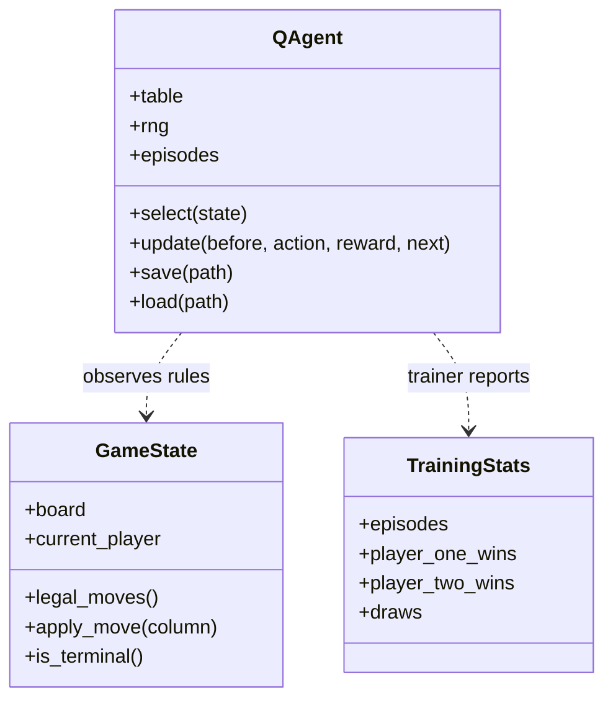

#### 2. Object Diagram (Flowchart Approximation)

A concrete cold-start snapshot illustrates runtime identities.

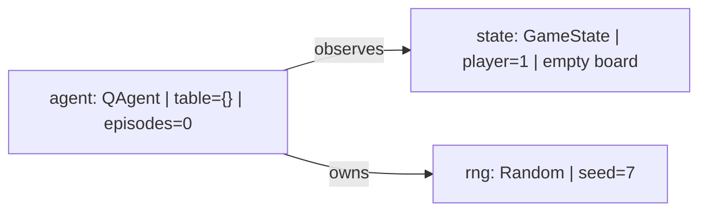

#### 3. Package Diagram (Flowchart Approximation)

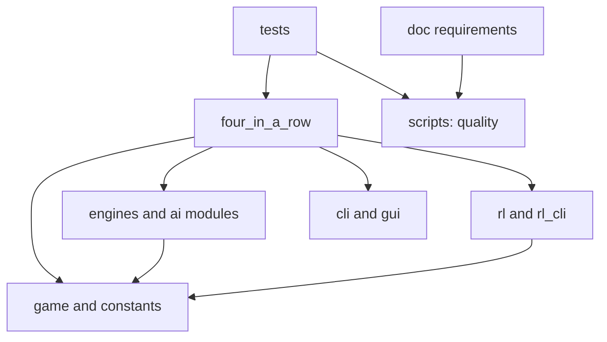

#### 4. Component Diagram (Flowchart Approximation)

Search engines are evaluation opponents, not the trainer's target source.

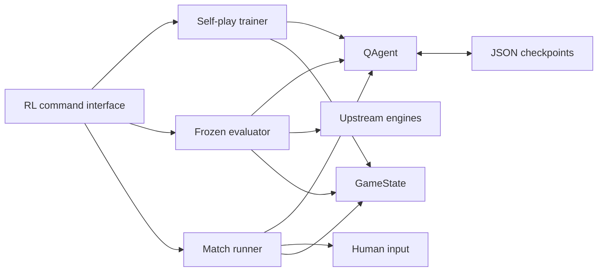

#### 5. Composite Structure (Flowchart Approximation)

Two independently configured seats operate on one shared board. Self-play
uses one agent in both seats; ordinary play may load two different agents.

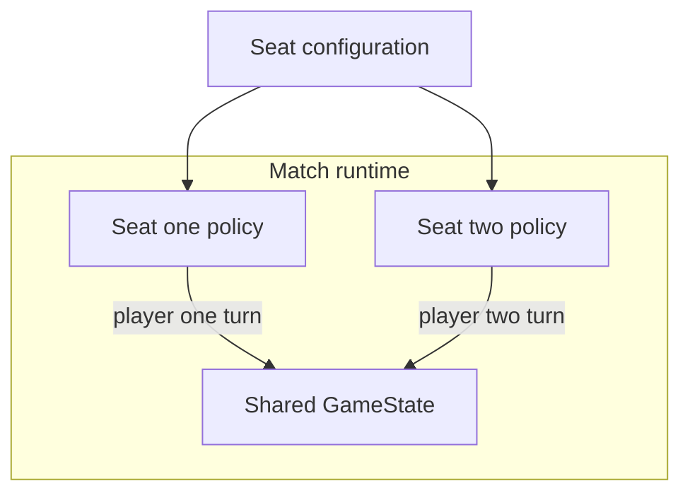

#### 6. Deployment Diagram (Flowchart Approximation)

The current baseline needs CPU only; no GPU, service, or ML framework.

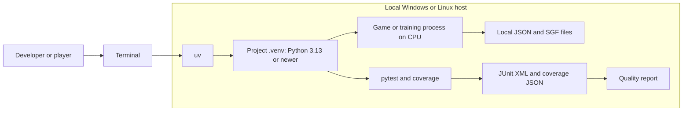

#### 7. Profile Diagram (Stereotype Approximation)

These stereotypes define project vocabulary, not a generated UML profile.

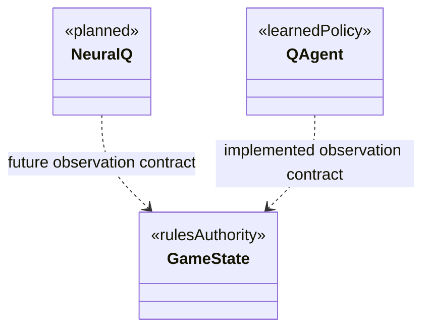

#### 8. Use Case Diagram (Flowchart Approximation)

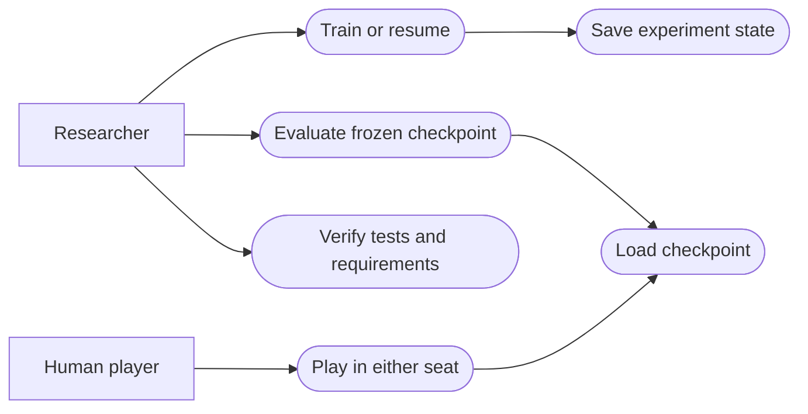

#### 9. Activity Diagram (Flowchart Approximation)

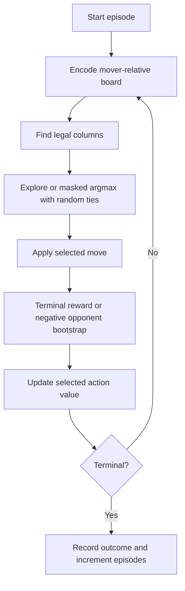

#### 10. State Machine Diagram

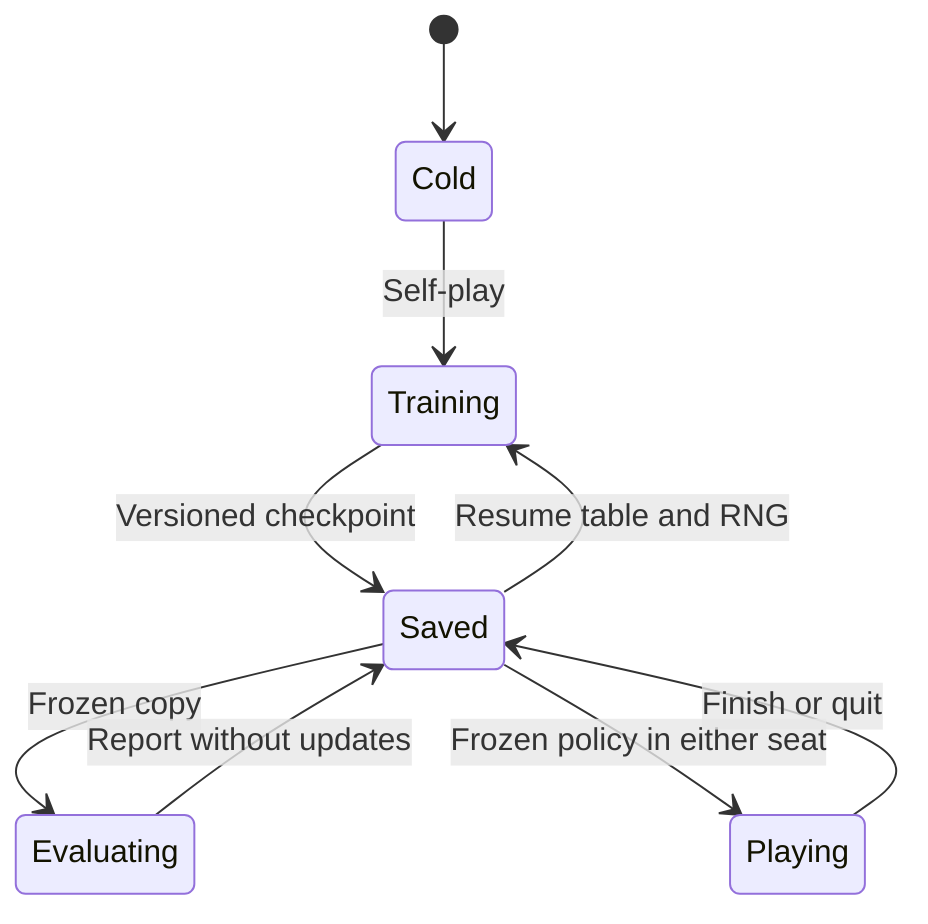

#### 11. Sequence Diagram

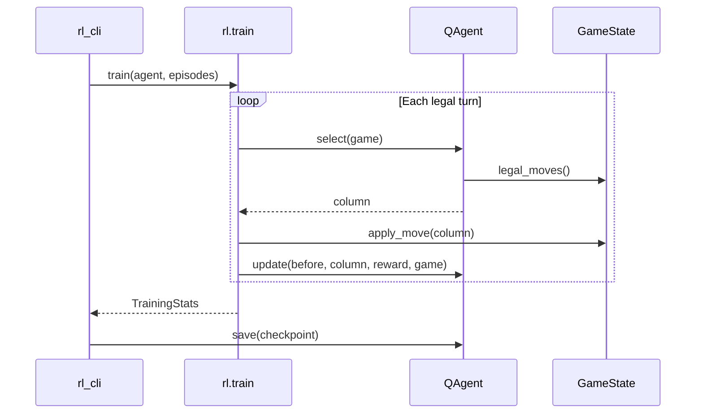

#### 12. Communication Diagram (Numbered Flow Approximation)

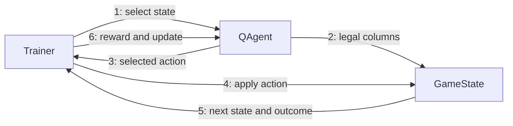

#### 13. Interaction Overview (Flowchart Approximation)

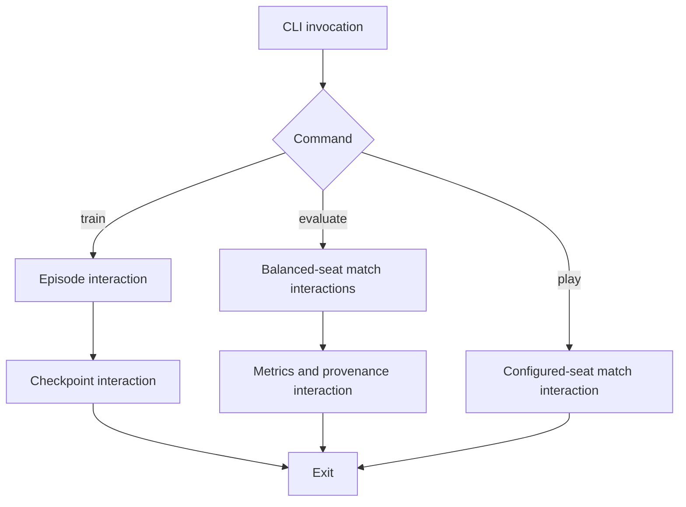

#### 14. Timing Diagram (Logical-Tick Sequence Approximation)

Ticks specify causal ordering, not measured latency. Mermaid has no native UML
timing diagram. Resource and performance budgets remain planned requirements.

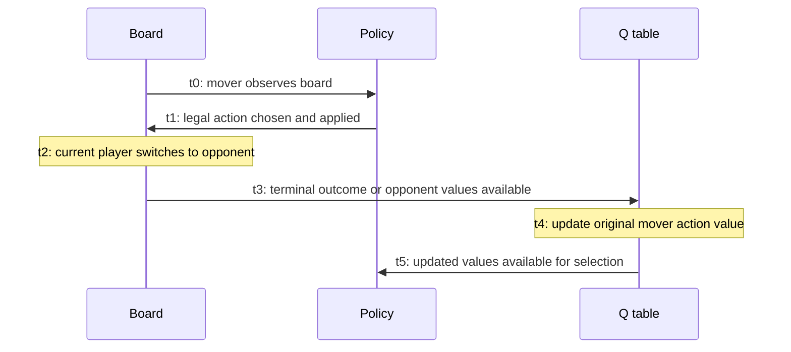

### Verification and Future Boundaries

PUCT snapshots now include an optional bounded frozen-policy history.
Archived opponents are immutable weight copies; actor sampling uses the
trainer's saved RNG. Historical games record only learner decisions and
alternate learner seats. Archival is distinct from strength promotion.
The benchmark owns a version-two fork-defense diagnostic set with preserved
legacy retention totals. Evaluation owns seeded paired legal opening prefixes.
Neither evaluation fixture labels nor search-engine scores feed training.
Requirements: FR-POOL-001, FR-FORK-DEFENSE-001, NFR-EVAL-DIVERSITY-001.

`rl_puct.py` adds a separate policy/value backend. Search nodes store values
from their own mover's perspective; parent exploitation negates child means.
Legal network priors guide PUCT bonuses, terminal rules override leaf
predictions, and search visits become self-play policy targets. Final mover
outcomes train the value head. Bounded reflected replay, optimizer, RNG,
counters and settings are checkpointed separately from DQN. The CLI detects
PUCT snapshots and reports search budgets and timings; `--no-search` measures
the unaided policy. See [the PUCT guide](puct.md) for formulas and data flow.

`rl_nn.py` now supports completed-game returns through `outcome_weight`.
Pending experience is limited to 42 moves, then labelled from each mover's
outcome and reflected into capped replay. Version-two snapshots store labels
and mixing settings; version-one loading retains TD-only behavior.
`rl_benchmark.py` owns evaluation-only tactical cases and frozen scoring.
The CLI exposes multi-seed checkpoint/cold-policy comparisons and explicit
outcome-mode upgrades. The trainer never imports the benchmark; diagnostic
labels are not training data. Requirements: FR-OUTCOME-001 and FR-TACTIC-001.

#### Implemented Neural Q Representation

`rl_nn.py` now implements `NeuralAgent`: three 6x7 mover-relative planes feed a
126-128-64-7 MLP with 24967 parameters. It implements the same `Learner` protocol
as `QAgent`, so the rules-only self-play loop is shared. Replay capacity is fixed;
Double DQN selects masked next actions online and evaluates them using a frozen
target network, with the opponent sign negated. Original/reflected transitions
train with Adam and Huber loss. See [implementation notes](rl_lessons_learned.md).

`rl_cli.py` defaults to neural training, lazily imports optional CPU PyTorch,
auto-detects JSON versus tensor checkpoints, and preserves the original engine
facade. Neural inference also remains in the RL CLI, not the GUI. Full snapshots
store online/target parameters, optimizer, capped replay, RNG, and counters;
compact inference exports omit training state and cannot resume. Restricted
tensor loading and schema checks reject malformed snapshots. Existing outputs
require explicit overwrite unless updating the resumed checkpoint.

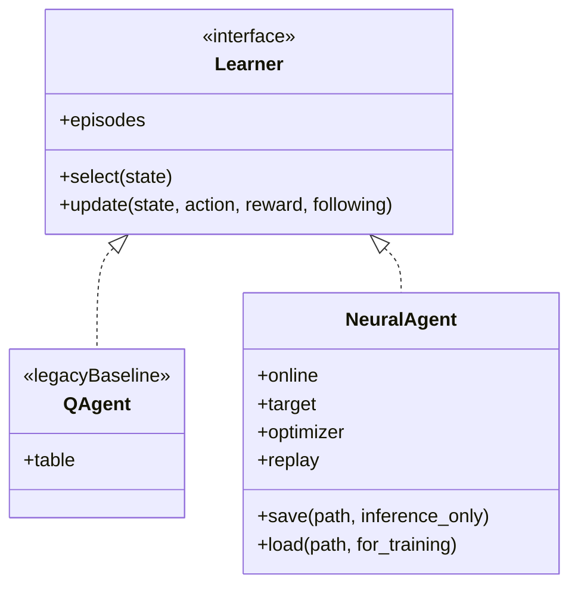

Tests carry suite-header requirement IDs. `scripts/quality.py` reconciles the
register with full-run JUnit results and headers, and gates statement, branch,
and named-function entry coverage independently above 95%. Run `uv run pytest`,
then `uv run python -m scripts.quality`, then `uv run zensical build`.
Coverage is not playing strength; frozen evaluation measures playing behavior.

Neural mechanics now retain rules, mask, reward, and evaluation contracts.
Historical opponents and PUCT remain future work. PyTorch is the optional `rl`
extra; tests and same-environment resume use `uv run --extra rl pytest`.
No current module promises mastership; acceptance needs independent evidence.

## Module Overview

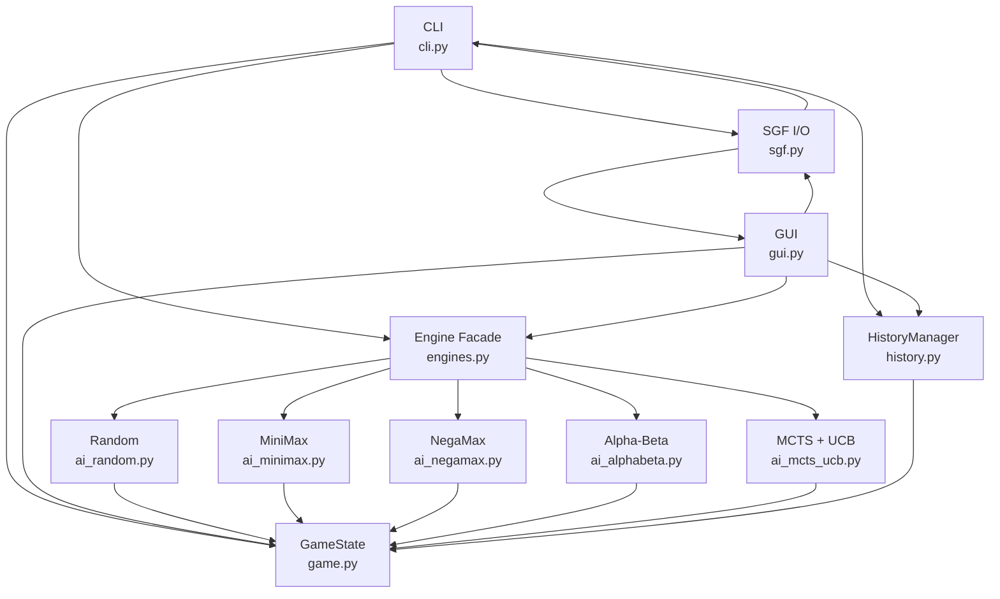

## Architectural Principle: Shared Core, Thin Front-Ends

The project follows a shared-core architecture:

- Core domain and rules live in `game.py` and `history.py`.
- Search behavior lives behind `engines.py` and the `ai_*` modules.
- Persistence lives in `sgf.py`.
- `cli.py` and `gui.py` are front-ends that orchestrate I/O and presentation.

This keeps game behavior consistent across terminal and GUI modes and avoids
duplicating rule logic in multiple entrypoints.

Practical change-placement rule:

- If a change affects game legality, winner detection, undo/replay, SGF
    validity, or engine decision logic, implement it in the shared core modules.
- If a change affects command wording, prompts, click handling, rendering, or
    frontend-specific UX, implement it in the respective front-end (`cli.py` or
    `gui.py`).

### Where to change what

Quick reference for contributors:

| Change type | File(s) to edit |
| --- | --- |
| Game rules or move legality | `game.py` |
| Winner / draw detection | `game.py` |
| Undo / replay semantics | `history.py`, then `cli.py` and/or `gui.py` |
| CLI prompt text or command wording | `cli.py` |
| Board rendering in terminal | `cli.py` |
| Board rendering in GUI | `gui.py` |
| Static board evaluation heuristic | `game.py` → `evaluate_state()` |
| New engine algorithm | new `ai_*.py` module + register in `engines.py` |
| SGF format or field names | `sgf.py` |
| Engine dispatch or public API | `engines.py` |
| Tests for game rules | `tests/test_game.py` |
| Tests for CLI commands | `tests/test_cli.py` |
| Tests for engine behavior | `tests/test_engine_*.py` |

## Core Domain Model

### `GameState` (`four_in_a_row/game.py`)

Responsibilities:

- Owns the board, move stack and current player.
- Validates moves and applies gravity.
- Supports undo of the most recent move.
- Detects winner/draw/terminal conditions.
- Renders board as terminal-friendly text.

Board representation:

- `board[row][column]`, where row 0 is the bottom row.
- Width = 7, height = 6.

Core model snapshot:

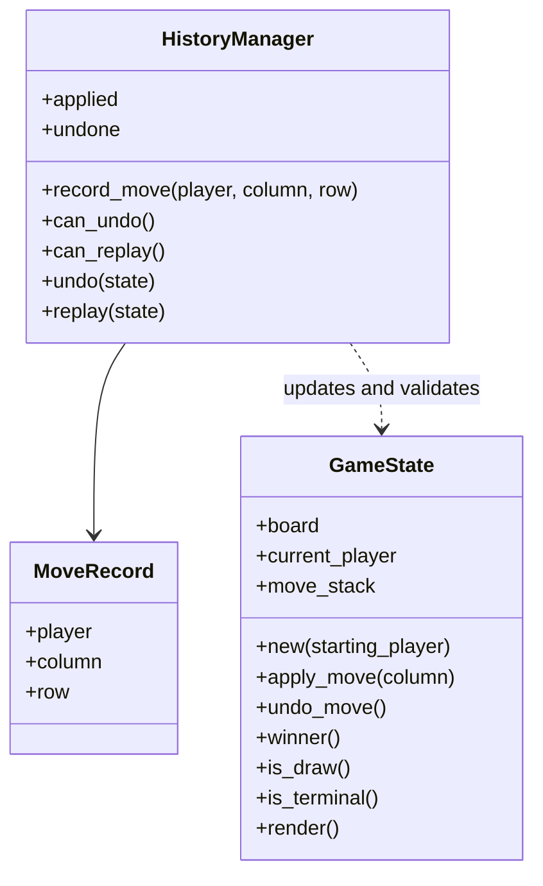

### `HistoryManager` (`four_in_a_row/history.py`)

Responsibilities:

- Records applied moves with player/column/row metadata.
- Supports `undo` and `replay` stacks.
- Verifies replay consistency against game state.

Undo/replay state transitions during active play:

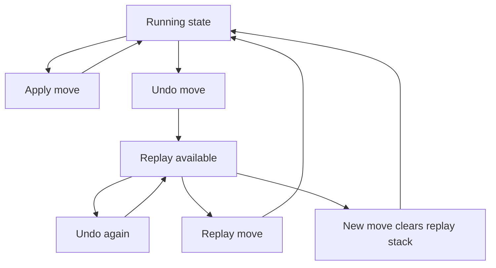

Finished-state recovery transitions:

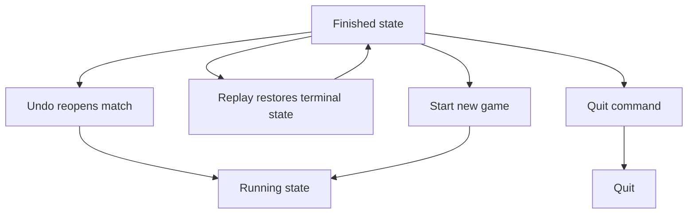

## SGF - The Smart Game Format

SGF is used as a GameState storage format here. Details are described in
[sgf.md](sgf.md), including replay-based legality validation during import.
For how SGF integrates into runtime behavior across front-ends, also see the
CLI and GUI flow sections below.

Persistence flow:

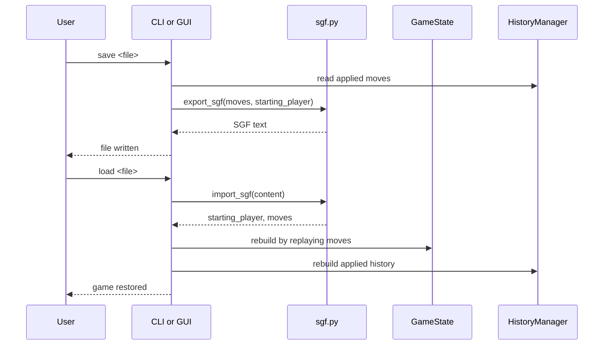

## Computer AIs - The Engines

Description of the available Computer Players, the Artificial Intelligence and
algorithms behind the scenes is in [engines.md](engines.md).

Implementation structure:

- `four_in_a_row/engines.py` provides the stable public API and dispatch.
- `four_in_a_row/ai_random.py` implements random move selection.
- `four_in_a_row/ai_minimax.py` implements depth-limited minimax.
- `four_in_a_row/ai_negamax.py` implements depth-limited negamax.
- `four_in_a_row/ai_alphabeta.py` implements alpha-beta search.
- `four_in_a_row/ai_mcts_ucb.py` implements MCTS with UCB-based selection.

### Suggest vs play flow

Both the CLI and GUI reach engine suggestions through `suggest_move()`. How the
result is used differs between `suggest` and `play`:

```mermaid
sequenceDiagram
    participant User
    participant Frontend as CLI or GUI
    participant Engines as engines.py
    participant AI as ai_*.py
    participant Game as GameState
    participant Hist as HistoryManager

    User->>Frontend: suggest <engine> [value]
    Frontend->>Engines: suggest_move(state, engine, ...)
    Engines->>AI: engine_suggestion(state, ...)
    AI-->>Engines: EngineSuggestion
    Engines-->>Frontend: EngineSuggestion
    Frontend-->>User: print move and evaluation (no board change)

    User->>Frontend: play <engine> [value]
    Frontend->>Engines: suggest_move(state, engine, ...)
    Engines->>AI: engine_suggestion(state, ...)
    AI-->>Engines: EngineSuggestion
    Engines-->>Frontend: EngineSuggestion
    Frontend->>Game: apply_move(suggestion.move)
    Frontend->>Hist: record_move(player, column, row)
    Frontend-->>User: board updated and re-rendered
```

The engine itself is always read-only with respect to `GameState`. All cloning
and mutation for search purposes happens internally in the `ai_*` modules.

## GUI Usage and Flow

Implemented in `four_in_a_row/gui.py` and started primarily via
`python -m four_in_a_row.gui`.

The GUI is a matplotlib-driven front-end over the same domain model and engine
facade used by the CLI.

Runtime flow:

1. Resolve player configuration for both sides (human or engine).
2. Create board figure and status area.
3. Render current game state from `GameState`.
4. Process either:
    - human click input (column selection), or
    - AI turn execution through `suggest_move()`.
5. Record applied moves through `HistoryManager`.
6. On terminal game state, display result and run post-game prompt
    (`help`, `save`, `new`, `quit`).

### GUI-to-code map

- GUI orchestration class: `FourInARowGui` in `four_in_a_row/gui.py`.
- Board rendering/status updates: `_create_plot()` and `_render_board()`.
- Winning-line detection/highlight: `_winning_cells()`.
- Human interaction: `_on_click()`.
- AI turn loop: `_play_ai_turn()` and `_handle_ai_until_human_turn()`.
- Post-game command loop and SGF export: `_handle_post_game_prompt_if_needed()`.

## CLI vs GUI Capability Matrix

This quick matrix helps contributors decide whether a behavior is shared-core
logic or frontend-specific behavior.

| Capability | CLI (`cli.py`) | GUI (`gui.py`) | Shared core module(s) |
| --- | --- | --- | --- |
| Start app | `python -m four_in_a_row` | `python -m four_in_a_row.gui` | n/a |
| Human move input | text commands (`1..7`, `move`) | mouse click on column | `game.py`, `history.py` |
| Single-step AI advice | `suggest <engine> [value]` | internal AI helper calls | `engines.py`, `ai_*.py` |
| Single-step AI play | `play <engine> [value]` | internal AI helper calls | `engines.py`, `ai_*.py` |
| Continuous engine-vs-engine progression | not provided in CLI loop | supported (autoplay loop) | `gui.py` orchestration + `engines.py` |
| Undo/replay during running match | explicit commands (`undo`, `replay`) | not exposed as click command | `history.py` |
| Save/load from command loop | `save`, `load` during active loop | post-game `save` command | `sgf.py` |
| Post-game control surface | text prompt (`new`, `quit`, etc.) | text prompt after GUI match (`help`, `save`, `new`, `quit`) | frontend-specific |
| Board rendering | terminal text board | matplotlib board and status text | frontend-specific |
| Win-line visual highlight | no | yes | `gui.py` |

## CLI Usage and Flow

Implemented in `four_in_a_row/cli.py` and started primarily via
`python -m four_in_a_row` through `four_in_a_row/__main__.py`.
`main.py` remains as a compatibility wrapper.

Runtime flow:

1. Start new game and print help.
2. Loop:

    - display board,
    - check terminal condition,
    - read command,
    - execute move/undo/replay/suggest/save/load.

By default both players are human-controlled. The CLI can also delegate a
single move to an engine through `play <engine>`, while `suggest <engine>`
remains the non-mutating AI suggestion path.

Prompt behavior:

- The running CLI prompt includes a compact move counter.
- `#n` means `n` moves are currently applied.
- `#current/total` is shown when replay is possible, so contributors can see
    both the active move count and the full recorded move count.
- `undo` and `replay` remain available after a terminal game state in the CLI.
    An `undo` from a finished game returns the match to a running state.

CLI command flow:

```mermaid
flowchart TD
    START[Start CLI] --> INIT[Create GameState and HistoryManager]
    INIT --> RENDER[Render board]
    RENDER --> CHECK{Winner or draw?}

    CHECK -- no --> PROMPT[Prompt user]
    CHECK -- yes --> FINISHED[Show result and finished prompt]

    PROMPT --> CMD{Command}
    FINISHED --> CMD

    CMD -- move or 1..7 --> APPLY[Apply move and record history]
    CMD -- undo --> UNDO[Undo moves]
    CMD -- replay --> REPLAY[Replay moves]
    CMD -- suggest --> SUGGEST[Compute engine suggestion]
    CMD -- play --> PLAY[Compute suggestion and apply move]
    CMD -- save --> SAVE[Export SGF]
    CMD -- load --> LOAD[Import SGF and rebuild state]
    CMD -- new --> NEW[Reset state and history]
    CMD -- quit --> EXIT[Exit CLI]

    APPLY --> RENDER
    UNDO --> RENDER
    REPLAY --> RENDER
    SUGGEST --> RENDER
    PLAY --> RENDER
    SAVE --> RENDER
    LOAD --> RENDER
    NEW --> RENDER
```

### Command-to-code map

The CLI command handling lives in `run_cli()` in `four_in_a_row/cli.py`.

- Move commands (`1..7`, `move`) call `GameState.apply_move()` and then
    `HistoryManager.record_move()`.
- Suggestion commands (`suggest`, `play`) call `suggest_move()` from
    `four_in_a_row/engines.py`.
- Suggestion output formatting uses `_print_suggestion()` in
    `four_in_a_row/cli.py`.
- CLI suggestion output converts internal 0-based engine columns into human
    facing columns `1..7`.
- Persistence commands (`save`, `load`) call `export_sgf()` and `import_sgf()`.
- Undo/replay commands call `HistoryManager.undo()` and `HistoryManager.replay()`.

## Testing Strategy

Tests are in `tests/` and cover:

- game rules and winner detection,
- history undo/replay behavior,
- SGF roundtrip and validation,
- engine suggestion contract,
- CLI interaction and command handling,
- GUI rendering and interaction branches,
- GUI post-game command handling and entrypoints.

GUI tests are organized semantically in `tests/gui/`:

- `test_gui_config.py`
- `test_gui_rendering.py`
- `test_gui_ai_flow.py`
- `test_gui_click_interaction.py`
- `test_gui_post_game_prompt.py`
- `test_gui_entrypoints.py`

`pytest-cov` is configured in `pyproject.toml`.
